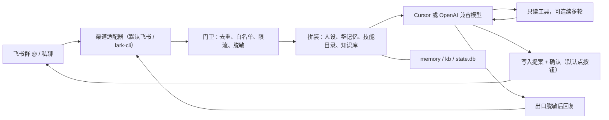

# Mimi Agent

[](CHANGELOG.md)
[](LICENSE)
[](scripts/setup.ps1)
[](docs/换模型.md)

飞书群助手开源模板，跑在你自己电脑上。有人在群里 @ 它，或者私聊它，它就用你这台电脑上的 Cursor（或你自己的 OpenAI 兼容模型账号）来回答。

这套模板来自幕景宇宙的群助手 Mimi。想先看看 Mimi 是什么样子，可以去[幕景宇宙官网的合作页](https://mujing-universe.pages.dev/contact/)直接和它聊几句，作品介绍在[这里](https://mujing-universe.pages.dev/works/mimi-agent/)。

## 谁适合用

- 团队或工作室主要在飞书群里沟通，想要一个能读文档、排日程、记事情的助手
- 在意数据去向：进程、密钥、聊天记忆和知识库都在自己电脑上，不进第三方托管
- 手上有 Cursor 订阅，或任一 OpenAI 兼容模型的 API Key
- 用 Windows（脚本按 Windows 写；其他平台照 [docs/新建智能体.md](docs/新建智能体.md) 的手动路径走）

它能看本群最近的聊天，读分享给它的文档、日历和多维表格，也能看图片和文件。要新建文档、建日程或往表格加记录时，必须由发起人本人确认，它才会动手。默认在卡片上点「确认」或「取消」。飞书还没开通卡片回调时，自动改回 6 位确认码。确认不能关掉。见 [docs/确认方式.md](docs/确认方式.md)。

每个群可以记自己的事：说「记一下」就记下，说「/记忆」就查看，说「/忘记」就删掉。

仓库里的配置都是占位符。App Secret、填好的群编号和文档编号、客户名名单、聊天记忆和知识库原文都不应该提交。

## English

A template for a Feishu (Lark) group bot that runs on your own computer. It answers @mentions in `chat_ids`, or—only if that list is empty and `chats.auto_join` is on—in groups that pass the admit gate (default: an allow-listed member sends `/认群`). It also answers allow-listed private chats, using Cursor or any OpenAI-compatible model whose API key stays in an environment variable. It can read recent chat, docs, calendars, and Bitable, and it writes only after the initiator confirms. The default is a one-time card button. A one-time code is used when card callbacks are not available. Confirmation cannot be turned off. Creative-workflow skills (topic scoring, spoken script, storyboard, a tool-neutral prompt pack, a brief, and a retro) live under `skills/` and stay off until `skills.enabled` is true. Configuration in this repository uses placeholders. Do not commit App Secrets, filled agent configs, customer-name lists, memory, logs, or real knowledge-base files. Apache-2.0.

## 架构

一条消息从飞书进来，先过门卫，再拼上下文，然后交给模型。模型若要读飞书，走只读工具；若要改飞书，先请发起人确认。回答出去之前再打一次码。



渠道这一层收事件、发消息、改卡片、读历史和成员。没写 `channel` 时就是飞书，行为与以前相同。别的渠道缺某项能力时，核心会跳过，不会假装做成了。说明在 [docs/渠道.md](docs/渠道.md)。企业微信接哪一种官方接口，见 [docs/渠道-企业微信.md](docs/渠道-企业微信.md)。

`--doctor` 不在这条路上。它只在本机做诊断，不发消息。本机还有两份不含问题原文的日志：`logs/events.jsonl` 和 `logs/journal.jsonl`。`logs/calls.jsonl` 默认记下每轮调用链，写入前会脱敏，见 [docs/调用记录.md](docs/调用记录.md)。

完整分层图和设计说明：

- [docs/架构.md](docs/架构.md)
- [docs/arch-now.mmd](docs/arch-now.mmd)（现在实际走的路）
- [docs/arch-full.mmd](docs/arch-full.mmd)（分层设计，含尚未默认打开的整理任务）
- [docs/memory-flow.mmd](docs/memory-flow.mmd)

## 功能

- 只在被 @ 或被允许的私聊里回答。断线私聊、早晨摘要和用量周报默认关。前两项见 [docs/断线提醒与晨报.md](docs/断线提醒与晨报.md)，周报见 [docs/用量周报.md](docs/用量周报.md)。
- 群默认仍看 `chat_ids`。要改成拉进群再认，把 `chat_ids` 留空并打开 `chats.auto_join`。默认还要白名单成员在群里发「/认群」，避免被陌生人拉进乱群消耗额度。见 [agents/CONFIG.md](agents/CONFIG.md)。
- 同一个话题接着聊；发「新话题」就清空这几轮上下文。
- 长期记忆按群分开。白名单里的人才能记和删，删除是真删。
- 进度卡片：先告诉你正在处理（默认关着，配置里打开）。
- 客户名按你的名单打成「某客户」。手机号、证件号、邮箱、密钥样子的字符串和电脑路径自动隐藏。
- 话题红线默认不设。要限制什么，写在自己的配置里。
- 同一个应用只跑一个进程。看门狗发现进程不在或心跳超过 3 分钟会在本机重启。默认只写 `logs/watchdog.log`。打开 `alerts` 后，重启前可以私聊主人。
- 知识库可以定时收进来，先放待审区，你确认后才换上。
- 分群知识库检索默认关着。打开后，本群的资料能被搜到，回答会写上来源标题、章节或页码。见 [docs/知识库.md](docs/知识库.md)。
- 技能默认关着。打开后，提示词里只放一行目录，命中触发词才放入步骤。创作流程（选题、口播、分镜、提示词、策划书、复盘）也在 `skills/` 里，默认不启用；要只用这几份时，在配置里点名。见 [docs/技能.md](docs/技能.md)。
- 常驻模式默认关着。`agent.mode` 写成 `acp` 后，Cursor 只启动一次。见 [docs/常驻模式.md](docs/常驻模式.md)。
- 模型可以换成你自己的账号：`model_provider` 写成 `openai_compat`，密钥放在环境变量。见 [docs/模型接口.md](docs/模型接口.md)。拿去参赛时的字段对照见 [docs/用本框架参赛.md](docs/用本框架参赛.md)。
- 也可以写 `model.provider` 换成 OpenAI 兼容接口或 Claude；不写时仍是 Cursor，行为与以前一样。见 [docs/换模型.md](docs/换模型.md)。

## 功能开关表

主人在和机器人的私聊里发「设置」，会收到一张分组卡片。功能名例如「用量周报」「离线告警」。点开关后，底部点「保存」才写入，可以一次改几项。卡片回调没连上时，回复序号，例如 `1 5`。群里不能改。确认方式也在这个私聊里改，回复「确认方式」，但不能关掉确认。步骤见 [docs/新手开关功能.md](docs/新手开关功能.md) 和 [docs/确认方式.md](docs/确认方式.md)。

| 功能 | 有什么用 | 怎么开 |
|---|---|---|
| 用量周报 | 每周私聊你一份用量合计，群里看不到明细 | 私聊发「设置」 |
| 知识检索 | 回答时引用这个群已经放进来的资料 | 私聊发「设置」 |
| 记忆成长 | 提议记住群里定过的事，有人点头才写入 | 私聊发「设置」 |
| 早间待办 | 早上往群里发今天的日程和未完成任务 | 私聊发「设置」 |
| 断线提醒 | 连不上时私聊主人 | 私聊发「设置」 |
| 技能 | 选题、写稿这类事按现成步骤做 | 私聊发「设置」 |

## 快速开始

第一次在 Windows 上给飞书装这个机器人，用安装向导。它会一题一题问，告诉你为什么要填、去飞书开放平台的哪一页复制。App Secret 只交给飞书命令行，不写进文件。

在仓库文件夹里打开 PowerShell，执行：

```text
powershell -NoProfile -ExecutionPolicy Bypass -File scripts\setup.ps1
```

说明和常见问题在 [docs/一键安装.md](docs/一键安装.md)。装好以后，用主人的飞书打开和机器人的私聊，发送「设置」再开各项功能。

只想先看它会问什么、不写文件：

```text
powershell -NoProfile -ExecutionPolicy Bypass -File scripts\setup.ps1 -DryRun
```

还没申请飞书应用、只想在自己电脑上跑通离线检查：看 [docs/快速开始.md](docs/快速开始.md)。遇到报错先看 [docs/排障.md](docs/排障.md)。

```text
python tests/run_tests.py
python checks/check_config.py agents/example.json
python setup_agent.py --name demo --provider deepseek --dry-run
python agentbot.py agents/example.json --doctor
```

最后一条只做只读诊断，不发消息。没有安装 lark-cli 时，它会列出缺什么。想对照每一项手写配置，看 [docs/新建智能体.md](docs/新建智能体.md)。已经有机器人、想换成这套（文档里的例子叫「小景」）看 [docs/升级已有智能体.md](docs/升级已有智能体.md)。

看 PDF 附件时才需要另外安装 `pypdf`。Word、PPT、文本、代码、zip 和图片用标准库。Excel 在装了 `openpyxl` 时读取。没装这些包也不会影响启动。

## English guide

The purpose, the write lock, and the “do not commit” rule are in the English paragraph at the top. The diagram in [架构](#架构) is the path from a Feishu message to a redacted reply. Omitting `channel` keeps that Feishu path. [docs/渠道.md](docs/渠道.md) is the adapter boundary; [docs/渠道-企业微信.md](docs/渠道-企业微信.md) is the WeCom design and is not enabled by default. [docs/arch-now.mmd](docs/arch-now.mmd) is the current path with the model choice. [docs/arch-full.mmd](docs/arch-full.mmd) is the longer design, including jobs that are not on by default.

On Windows, first-time setup is `scripts\setup.ps1`. It asks one question at a time and does not write the App Secret into a file. See [docs/一键安装.md](docs/一键安装.md). A 15-minute offline start is in [docs/快速开始.md](docs/快速开始.md). Troubleshooting is in [docs/排障.md](docs/排障.md). `--doctor` only prints a local diagnosis and does not send messages. Disconnect alerts and the morning digest are off unless `alerts.enabled` and `digest.enabled` are true. The weekly usage report is also off unless `report.enabled` is true, and it is a private message. See [docs/断线提醒与晨报.md](docs/断线提醒与晨报.md) and [docs/用量周报.md](docs/用量周报.md).

Quick start on a machine that will really talk to Feishu:

1. Copy `agents/example.json` to a new filename. That copy is gitignored.
2. Replace every `REPLACE_` value with your own ids. Do not put an App Secret in the file.
3. Copy `redact.example.txt` to `redact.txt`. Leave it empty if you have no customer names to hide.
4. On Windows, from the repository root, run `scripts\start.ps1 -Config agents\<your-file>.json`.

Offline tests do not need Feishu or extra packages:

```text
python tests/run_tests.py
```

The last line prints how many checks passed. Do not commit filled-in `agents/*.json`, `redact.txt`, `.env`, `memory/`, `logs/`, `state/`, `state.db`, or real files under `kb/`.

Per-group search is off unless `knowledge.enabled` is true. Turning it on indexes that chat only, cites the title and section or page, and does not add Feishu scopes until you opt in. See [docs/知识库.md](docs/知识库.md).

A screenshot placeholder, with rules for hiding ids, is in [docs/demo/README.md](docs/demo/README.md).

## 配置说明

每一项的意思在 [agents/CONFIG.md](agents/CONFIG.md)。常用的几项：

| 键 | 填什么 |
|---|---|
| `profile` | 你在 lark-cli 里起的名字，不是密钥 |
| `bot_open_id` | 机器人自己的编号 |
| `chat_ids` | 允许回答的群。写了就只用它 |
| `chats.auto_join` | 默认 `false`。`chat_ids` 留空后才生效 |
| `chats.admit` | 自动认群的门槛，默认 `confirm`（要 `/认群`） |
| `write.allowed_users` | 谁可以发起写入和改群记忆 |
| `write.resources` | 允许新建或追加的文件夹、文档、日历、多维表格 |
| `model_provider` | `cursor`（默认）或 `openai_compat` |
| `agent.api_key_env` | 只写环境变量的名字，不写密钥本身 |
| `agent.max_tool_rounds` | 只读工具最多连续几轮。不写是 `4` |
| `agent.stall_sec` | 多久没有新输出算卡住。不写是 `300`，写成 `0` 仍按 300 |
| `tools.message_attachment` | 读当前会话的历史附件。不写时跟着附件开关 |
| `shutdown_wait_sec` | 停机再等多久。不写是 `15` 秒 |
| `link_jump_sec` | 休眠多久后重连。不写是 `20` 秒 |
| `catchup.max_age_sec` | 补答最多回溯多久。不写是 12 小时 |
| `redact_file` | 客户名名单，默认 `redact.txt`，不要提交 |
| `alerts` | 长连接或心跳不健康时私聊主人。不写或 `enabled` 为 `false` 时不发 |
| `digest` | 到点往指定群发一条今日摘要。不写或 `enabled` 为 `false` 时不发。不会点名所有人 |
| `report` | 每周私聊主人一份用量合计。不写或 `enabled` 为 `false` 时不发。没有问题原文和编号 |

`REPLACE_` 开头的值必须换成你自己的，留着不能启动。

只读轮数、附件数、PDF 页数、文档字数和各项读取上限的默认值不改。额度充足时可以抄 [docs/宽松配置示例.md](docs/宽松配置示例.md)，那一段不进 `agents/example.json`。

## 安全说明

写操作要同时满足三道锁：人在白名单里、资源在白名单里、动作属于允许的几类（新建文档、文末追加、建日程、改日程、删日程、加一条表格记录）。发起人还要在原来的会话里确认。默认点卡片上的按钮；没开通卡片回调时改回确认码。确认不能关掉。不删消息、文档和表格记录。删日程不通知参会人。没有覆盖全文、没有改权限。

密钥放在你自己的电脑上：飞书 App Secret 只在 `lark-cli config init --name <profile> --app-secret-stdin` 时输入。`<profile>` 必须和配置里的 `profile` 相同。不写 `--name` 会使用默认 profile，覆盖这台电脑上其他机器人已经登录的 profile。模型密钥只进环境变量。

不要提交这些文件：填好的 `agents/*.json`、`redact.txt`、`memory/`、`logs/`、`state/`、`state.db`、`kb/` 里的真实资料、`.env`。

细节见 [SECURITY.md](SECURITY.md) 和 [docs/安全红线.md](docs/安全红线.md)。

## 文件

| 文件 | 作用 |
|---|---|
| `agentbot.py` | 主程序：收消息、决定回不回、叫模型、回复 |
| `channels/` | 渠道接口。默认飞书；`memory` 只给测试；企业微信是实验骨架，默认不连接 |
| `providers/` | 模型接口。默认 `cursor`；`openai_compat` 接你自己的账号；`fake` 只给测试用 |
| `acp_client.py` | 可选的常驻进程。默认不用 |
| `tools.py` | 动飞书的手：只读，以及要确认的写入 |
| `confirm_mode.py` | 确认方式。默认点按钮，不能关掉。见 [docs/确认方式.md](docs/确认方式.md) |
| `guard.py` | 打码和话题红线 |
| `memory.py` | 每个群一份长期记忆 |
| `memory_growth.py` | 记忆成长。默认关。提议后要审批才写入。见 [docs/记忆成长.md](docs/记忆成长.md) |
| `retrospect.py` | 复盘写回。默认关。点头才写入该群记忆。见 [docs/复盘写回.md](docs/复盘写回.md) |
| `skill_evolve.py` | 技能自动改进。默认关。分数更高且确认后才替换。见 [docs/技能自动改进.md](docs/技能自动改进.md) |
| `crew.py` | 主理人加专员。默认关。只读拆分，写入仍要确认。见 [docs/主理人与专员.md](docs/主理人与专员.md) |
| `skills.py` | 技能目录、触发词预放和按需读取；默认关闭 |
| `skills/` | 每个技能一个文件夹，里面一份 `SKILL.md` |
| `kb_sync.py` | 知识库先待审、再替换 |
| `knowledge.py` | 分群知识库索引和检索。默认关。见 [docs/知识库.md](docs/知识库.md) |
| `make_bundle.py` | 在资料电脑上把笔记打成压缩包 |
| `agents/example.json` | 配置样子，里面都是占位符 |
| `agents/CONFIG.md` | 每一项怎么填 |
| `redact.example.txt` | 空的客户名名单样子，复制成 `redact.txt` 再用 |
| `doctor.py` | `--doctor`：只读诊断，不发消息 |
| `observe.py` | 本机 `logs/events.jsonl` |
| `calltrace.py` | 本机调用链 `logs/calls.jsonl`。默认开。见 [docs/调用记录.md](docs/调用记录.md) |
| `lifecycle.py` | 单实例锁和优雅停机 |
| `feishu_link.py` | 长连接，以及休眠后的重连 |
| `outbound.py` | 飞书渠道主动发送时调用的 `im +messages-send`。断线私聊和早晨摘要经 `push_text` 走到这里 |
| `health_alert.py` | 断线提醒。默认关 |
| `digest.py` | 早晨摘要。默认关。每个群每天最多一条 |
| `usage.py` | 用量周报。默认关。每周私聊一次，重启不重发 |
| `feature_switch.py` | 主人在私聊里开关功能。见 [docs/新手开关功能.md](docs/新手开关功能.md) |
| `scripts/reload.ps1` | 改完开关后平滑重启：先停，确认没有第二个接收进程，再启动 |
| `docs/断线提醒与晨报.md` | 断线提醒和早晨摘要怎么开，以及飞书要哪些权限 |
| `docs/用量周报.md` | 用量周报怎么开，统计什么，什么不会写进去 |
| `docs/调用记录.md` | 每轮调用链写在本机，主人私聊可看，周报只加合计 |
| `docs/复盘写回.md` | 一轮做完后提议一句短复盘，确认后才写入该群记忆 |
| `docs/技能自动改进.md` | 提议技能下一版，回归分数更高且主人确认后才替换，可回滚 |
| `docs/主理人与专员.md` | 复杂问题拆给只读专员，有总预算和每步预算 |
| `docs/新手开关功能.md` | 主人在私聊里发「设置」，打开或关掉上面几项 |
| `docs/确认方式.md` | 写入确认：默认点按钮，可改回确认码，不能关掉 |
| `setup_wizard.py` | 一键安装向导。一次一问，密钥不进文件。见 [docs/一键安装.md](docs/一键安装.md) |
| `setup_agent.py` | 干跑生成配置。不加 `--write` 不写文件 |
| `scripts/setup.ps1` | Windows 上的安装入口，调用上面的向导 |
| `scripts/` | Windows 上的启动、停止、看门狗、计划任务、`verify_windows.ps1` |
| `tests/run_tests.py` | 离线测试。通过时最后一行打印条数 |
| `evals/run.py` | 回答质量回归。假模型不连飞书；用法见 [docs/回归测试.md](docs/回归测试.md) |
| `docs/一键安装.md` | 第一次在 Windows 上安装：一题一题问，密钥不进文件 |
| `docs/快速开始.md` | 新人 15 分钟跑起来 |
| `docs/排障.md` | 常见问题 |
| `docs/release-0.9.0.md` | v0.9.0 发布说明（2026-10-20）。调用记录、复盘写回、技能自动改进、主理人加专员 |
| `docs/release-0.8.1.md` | v0.8.1 发布说明（2026-10-20）。卡片回调没开通时不再误报断线，也不反复重启 |
| `docs/release-0.8.0.md` | v0.8.0 发布说明（2026-10-20）。一键安装向导；写入默认点卡片，没开回调时退回确认码 |
| `docs/升级到0.8.0.md` | 从 0.7.0 升到 0.8.0：旧配置不用改；要在飞书后台加 `card.action.trigger` |
| `docs/release-0.7.0.md` | v0.7.0 发布说明（2026-10-20）。不写 `model` 仍是 Cursor；`search` 默认关；私聊可以开关已有功能 |
| `docs/升级到0.7.0.md` | 从 0.6.0 升到 0.7.0：旧配置不用改；停进程和 `git reset --keep` 同一步 |
| `docs/release-0.6.0.md` | v0.6.0 发布说明（2026-10-20）。四项默认关 |
| `docs/升级到0.6.0.md` | 从 0.5.0 升到 0.6.0：停进程和 `git reset --keep` 同一步；可选只开用量周报 |
| `docs/release-0.5.0.md` | v0.5.0 发布说明（2026-10-19） |
| `docs/升级到0.5.0.md` | 从 0.4.1 升到 0.5.0：默认不用改配置；可选打开技能、断线提醒、早晨摘要 |
| `docs/release-0.4.1.md` | v0.4.1 发布说明（2026-10-19） |
| `docs/升级到0.4.1.md` | 从 0.4.0 升到 0.4.1：可选打开按群成员私聊，确认码表自动建 |
| `docs/release-0.4.0.md` | v0.4.0 发布说明（2026-10-19） |
| `docs/宽松配置示例.md` | 可选：把只读轮数、附件数、PDF 页数、文档字数和各项读取上限调大。默认值不变 |
| `docs/` | 给人看的说明和架构图 |
| `SKILL.md` | 给帮忙操作的 AI 助手看的步骤 |

## 参与贡献

看 [CONTRIBUTING.md](CONTRIBUTING.md)。行为约定见 [CODE_OF_CONDUCT.md](CODE_OF_CONDUCT.md)。

## 许可证

本项目以 Apache-2.0 开源。你可以商用、修改、再分发，需要保留许可证和版权声明。全文见 [LICENSE](LICENSE)，版权信息见 [NOTICE](NOTICE)。

本项目调用的第三方模型和工具（例如 Cursor CLI、各家模型 API、飞书开放平台）各有自己的服务条款。使用者需要自己遵守这些条款，并使用自己的账号。
