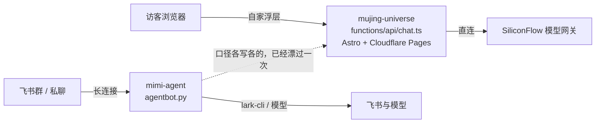

# 多入口对照与方案

调研日期：2026-11-04。这一页回答一件事：官网浮层里的 Mimi 和飞书群里的 Mimi，能不能收到同一个脑子底下，怎么做。

结论先说：能，但不是把两个运行时并成一个进程。按成熟案例的分层，先做到「一处真相」，再加一条「只进不出」的接待桥；浏览器入口该由谁守，还是由官网那侧守着。三步里前两步和接待桥已经落进仓库，剩下一步写在文末，没有做。

外面这些项目的做法，全部来自实际打开过的官方文档或仓库源码，链接在每一小节末尾。有一处没找到明写：LangBot 文档没有说 Web Page Bot 用的什么传输，得看它的源码才知道是 WebSocket，这种情况在文中直说。

## 我们现在是什么样

两个 Mimi，各自独立，谁也不知道谁存在。



左边那套是官网的：提示词、禁词、限流、`[[COOP]]` 交接全写死在 `functions/api/chat.ts` 里，509 行，一个函数干完鉴权、限流、拼提示词、剥标记。它没有会话记忆，刷新就没了。

右边那套是本仓库：核心在 `agentbot.py`，耳朵和嘴在 `channels/`，脱敏和红线在 `guard.py`，写入要白名单加 6 位确认码，主动出门的三条道是早晨摘要 `digest`、播报 `broadcast`、用量周报 `report`，都是到点自己发。

漂过的证据就一条：官网提示词里写着开源模板地址是 `https://github.com/endtree-FDE/feishu-group-agent`。仓库已改名 `mimi-agent`，旧地址 301 跳新地址，链接没坏，但访客听到的介绍落后于事实。这件事写在 [对外口径.md](对外口径.md)。

## 成熟案例怎么做多入口

三个项目，三种分层，共同点很一致：核心只认一套归一化消息，入口的差异留在入口。

### LangBot：一个平台适配层，两种对外形态

Web Page Bot 是「把机器人嵌到别人页面上」。页面里加一段脚本，地址带机器人的 uuid：

```html
<script data-title="LangBot" src="http://localhost:5300/api/v1/embed/<bot_uuid>"></script>
```

服务端 `GET /api/v1/embed/{bot_uuid}/widget.js` 吐浮层脚本，聊天走 **Quart WebSocket** `/api/v1/embed/<bot_uuid>/ws/connect`，历史走 `GET /<bot_uuid>/messages/<session_type>`。这一条文档没写传输方式，是从 `groups/pipelines/embed.py` 和 `sources/web_page_bot_adapter.py` 读出来的。

三个设计点值得抄：

- 嵌入路由是 `auth_type=AuthType.NONE`——浏览器里不可能藏密钥，它索性不装。人机验证靠可选的 Cloudflare Turnstile，把 `{ts}.{hmac}` 当作 WebSocket 的第一帧 `authenticate` 发上去。身份问题交给一个第三方签发的小凭据，自己不做账号体系。
- 连接数有硬上限：全局默认 1024，单个工作区 32，超了回 429。面向公网的入口，先按「会被很多人同时打开」设计。
- HTTP Bot 是另一种形态：调用方 `POST /bots/<bot_uuid>`，HMAC-SHA256 签请求体，头是 `X-LB-Timestamp` 和 `X-LB-Signature`，时间窗 ±300 秒；重复的幂等键回 409，超过 1 MiB 回 413，收到就立即回 202，结果用签名回调送回。最关键的一句是防 SSRF：**回调地址只能来自配置，不接受请求里给的地址**。会话 id 由调用方提供，平台不管你是谁，只保证同一个 `session_id` 落进同一个会话。

它的适配器抽象边界写在 workshop 文档里：适配器负责把平台事件翻成归一化消息、把归一化消息翻成平台发送，别的都不管。

来源：[Web Page Bot 文档](https://langbot.app/docs/zh/usage/platforms/webpage.md)、[HTTP Bot 文档](https://langbot.app/docs/zh/usage/platforms/http-bot.md)、[平台适配器开发指南](https://langbot.app/docs/zh/workshop/impl-platform-adapter.md)、[embed 路由源码](https://raw.githubusercontent.com/langbot-app/LangBot/master/src/langbot/pkg/api/http/controller/groups/pipelines/embed.py)、[web_page_bot_adapter.py](https://raw.githubusercontent.com/langbot-app/LangBot/master/src/langbot/pkg/platform/sources/web_page_bot_adapter.py)。它的平台列表里确实同时有 Web Page Bot 和 HTTP Bot（[仓库 wiki](https://github.com/langbot-app/LangBot/wiki/zh-articles-langbot-telegram-sandbox-agent)）。

### AstrBot：适配器只声明两个能力位，webchat 不自建服务

适配器必须实现 `run()` 和 `meta()`，可以覆写 `send_by_session()`、`terminate()`、`commit_event()`，用 `@register_platform_adapter` 注册进平台管理器。`PlatformMetadata` 里跟多入口有关的是两个布尔位：`support_streaming_message`、`support_proactive_message`——能不能流式、能不能主动推，缺了就把这一格降级，不假装做成了。

会话键是全平台统一的一行：`f"{platform_id}:{message_type}:{session_id}"`，代码里叫 `unified_msg_origin`。webchat 的 id 形如 `webchat!{username}!{cid}`。跨入口的「同一个人 / 同一个会话」就是靠这个组合键解决的，不需要一个全局用户系统。

对我们最有用的一件事：**webchat 适配器自己不启服务**。它复用 WebUI 那个 FastAPI 应用，答复用 `StreamingResponse(media_type="text/event-stream")` 走 SSE 推回去，路由外面套 `require_chat_scope` 鉴权。也就是说浏览器入口被当成「WebUI 的一个页面」，不是「一个新平台的服务」。同一份文档没写的是安全边界：WebUI 默认绑 `0.0.0.0:6185`——默认对局域网开放，靠登录态守门。

来源：[platform.py](https://raw.githubusercontent.com/AstrBotDevs/AstrBot/master/astrbot/core/platform/platform.py)、[webchat_adapter.py](https://raw.githubusercontent.com/AstrBotDevs/AstrBot/master/astrbot/core/platform/sources/webchat/webchat_adapter.py)、[dashboard/api/chat.py](https://raw.githubusercontent.com/AstrBotDevs/AstrBot/master/astrbot/dashboard/api/chat.py)、[dashboard/server.py](https://raw.githubusercontent.com/AstrBotDevs/AstrBot/master/astrbot/dashboard/server.py)、[message_session.py](https://raw.githubusercontent.com/AstrBotDevs/AstrBot/master/astrbot/core/platform/message_session.py)。

### NoneBot2：传输和能力位拆成 driver 与 mixin

NoneBot2 把「怎么收发」叫 driver，分两类：Forward（我作为客户端出去）和 Reverse（我作为服务端等人进来，含 WebHook 和反向 WebSocket 客户端）。声明方式是语法 `<module>[:<Driver>][+<module>[:<Mixin>]]*`，能力按 Mixin 叠加（HTTPClient / HTTPServer / WebSocketClient / WebSocketServer）。配置里**服务端类型的 driver 最多一个**。内置可选 `~fastapi`（ASGI，默认）、`~quart`、`~aiohttp`、`~httpx`、`~websockets`、`~none`。

适配器不碰端口，只做翻译：用 `driver.register_adapter()` 把自己挂上 driver，收事件的回调通过 `HTTPServerSetup` / `WebSocketServerSetup` 挂到那个唯一的服务端上。**传输归 driver，协议归 adapter**——这句话是多入口最干净的分工。

权限那一层的分工也值得记住：核心 `nonebot.permission` 只有 USER / SUPERUSER / Message / Notice / Request / MetaEvent，`PRIVATE`、`GROUP`、`GROUP_OWNER` 这些是各家 adapter 自己定义的。身份语义属于入口，不属于核心。会话同理，`get_session_id()` 的说明是「通常为机器人用户 ID 与群聊/频道 ID 组合而成」。

来源：[driver 文档](https://nonebot.dev/docs/advanced/driver)、[adapter 文档](https://nonebot.dev/docs/advanced/adapter)、[适配器编写指南](https://nonebot.dev/docs/developer/adapter-writing)、[permission API](https://nonebot.dev/docs/api/permission)、[onebot v11 permission.py](https://raw.githubusercontent.com/nonebot/adapter-onebot/master/nonebot/adapters/onebot/v11/permission.py)。

## 三家和我们，同一张表

| 分层 | LangBot | AstrBot | NoneBot2 | 本仓库 |
|---|---|---|---|---|
| 核心只认归一化事件 | 平台适配层 | `Message` | `Event` | 有：`channels/base.py` 的事件结构，`agentbot.py` 不认识 lark-cli |
| 能力位 / 缺就降级 | 平台 config 项 | `PlatformMetadata` 两个布尔位 | Mixin | 有：`Cap.*` 16 项、`TOOL_CAPS`、`_UNAVAILABLE` 一句人话 |
| 入站传输（浏览器可达） | 自建 HTTP + WebSocket 服务 | 复用 WebUI 的 FastAPI，SSE | 唯一的 Reverse driver（ASGI） | **没有**。全仓库没有一个服务端监听，只有长连接出去 |
| 会话键跨入口 | HTTP Bot 由调用方给 `session_id` | `platform_id:message_type:session_id` | `get_session_id()` 组 id | 按 `chat_id` / `sender_id`，只在飞书语义内 |
| 对外鉴权 | 嵌入路由不装鉴权 + 可选 Turnstile；HTTP Bot HMAC 签名 | `require_chat_scope` 登录态 | 归 adapter | 只有「谁能在飞书里说话」：`p2p_can_reply` / `p2p_limited` |
| 公网配额 | 连接数上限，超额 429 | 未文档化 | 未文档化 | 只有单人/每小时限流，面向群成员，不是面向访客 |
| 主动推送 | 平台侧 | `support_proactive_message` | 归 adapter | 有：`digest` / `broadcast` / `report` 三条定时出口 |
| 从外部收数据 | 平台事件 | 平台事件 | 平台事件 | 新加一条：`intake.py` 到点出去拉，只写文件不发消息 |

## 我们已经有什么，别重复造

`channels/base.py` 把 16 项能力列成 `Cap` 常量，`TOOL_CAPS` 把模型工具名映射到需要的能力，`_UNAVAILABLE` 给每项缺能力时的一句人话。这套东西的用途正是三家说的同一件事：**新入口缺哪一格，就在哪一格降级，不许假装成功**。企业微信骨架 `channels/wecom.py` 已经按这个契约实现过一次（不连接，只声明能力），说明这层抽象不是纸上的。

`p2p_can_reply()` 和 `p2p_limited()`（`agentbot.py` 第 836、843 行）是访客档：私聊对所有人开放时，不在名单里的人能聊天，但用不了飞书工具和技能。这就是 NoneBot2 说的「身份语义属于入口」，我们已经有了入口级的权限分层，只是它只有「熟人 / 生人」两档，没有「公网匿名访客」这一档。

出口侧的护栏是现成的，接待桥直接复用：`guard.safe_path` 拒绝对盘符和 `..`，`guard.redact` 打码客户名和手机号，`guard.neutralize` 把 `<<tool>>` 这类标记改成全角占位，`acp_client._public_http_url` 拒绝非 http(s)、带 userinfo、超长主机名、控制字符和内网地址。真正连出去之前还有第二道：`broadcast._http_get` 用 `acp_client._public_addrs` 把域名再解析一遍，两次结果不一致、或解析结果落在内网，就不连。`digest.outbound_lock` 那把锁保证同一时刻只有一段代码在出门。

## 缺什么，按成熟案例的口径说清

一、**没有浏览器可达的入站传输。** 这不是漏写，是这台机器的物理限制：只有出去的长连接，没有能对公网开放的端口。三家都假设有（或复用）一个 Web 服务；我们没有，所以任何「官网把访客的话送到飞书这边」的想法都必须走出去的这一侧——这就是 `intake.py` 做成拉取而不是推送的原因。

二、**没有跨入口的会话键抽象。** AstrBot 用 `platform_id:message_type:session_id` 一行解决，我们按 `chat_id` 分记忆，官网那侧根本没有会话持久化。要做「同一个访客在两边接着聊」，先得有这样一个组合键，且明确它是本地 id，不外传。

三、**没有面向调用者的配额。** LangBot 对嵌入入口给的是全局 1024 / 单工作区 32 / 429；我们的限流假设「群里十个人」，量级差三个数量级。接待桥不需要它（拉的是自己写的文件），但真做入站就必须补。

四、**没有浏览器侧的身份与凭据。** LangBot 的选择是不装鉴权、把人机验证外包给 Turnstile，因为「脚本里放密钥」本来就是假安全。我们如果将来要接，也应该照这个顺序：公开入口 + 第三方签发的小凭据，而不是给访客发 token。

## 对外入口的边界与失败模式

这一节是把「如果做入站会怎么坏」逐条落到现有代码上，每条都写明现在谁在守。

| 会怎么坏 | 现实路径 | 现在谁在守 |
|---|---|---|
| SSRF：让服务器去访问内网 | 请求里带回调地址 / 拉取地址由外部给 | LangBot 靠「回调地址只从配置读」；我们靠 `url` 只写在实例配置里，`intake._url_ok` 先用 `_public_http_url` 判形状和内网，真连之前 `_http_get` 还要两次解析结果一致、且都不是内网才连 |
| 请求头注入 | 访客文本拼进 header | `broadcast._http_get` 见到 `\r\n\t\x00` 直接 `blocked`，连都不连；`intake._headers` 先查环境变量里的 token |
| 访客话里的提示词注入 | 「忽略以上指令」进上下文 | `guard.neutralize` 吃掉 `<<tool>>` 这类标记；注意 colon 形式 `<<TOOL:name>>` 不在 `_MARK` 的匹配里，这一格没守住 |
| 泄密：客户名、手机号、保密项目名 | 出站的正文 | `guard.redact` 在出口统一打码；官网侧另有禁词正则整条替换 |
| 密钥外流 | 写进配置、写进日志、进正文 | `token_env` 只记变量名不记值；`guard.embeds_secret` 判定含密钥的条目直接丢弃；`--check` 的 HINT 会喊 |
| 超量：一个访客刷爆额度 | 无限拉、无限写 | 单次正文上限 4096 字节、一条最多 20 项、最短间隔 15 分钟；写不进就退默认路径 |
| 并发写坏文件 | 两段代码同时写同一个文件 | `digest.outbound_lock` 5 秒耐心；拉取的网络等待不占锁，拿不到锁就记 `busy` 本轮不做 |
| 幂等：同一意向播报两次 | 端点重复返回 | `state/intake_state.json` 按 id（没有 id 就用正文哈希）去重，留最近 500 条 |
| 时区把「次日」算错 | Windows 上没有 tzdata | `digest.zone` 的固定偏移兜底；`intake` 复用同一个函数，未知时区名就不拉 |
| 训练数据被污染 | 陌生访客的话进知识库 | 接待桥只写 `intake/leads.md`，那个文件在 `.gitignore` 里，不进知识库、不进记忆 |
| 误发：把待审正文当已审发出去 | 自动挂上播报 | 必须人复制进 `broadcast/pending.txt`；`--dry-run`、`--check`、`--doctor` 一律不发，测试用假发送落点证明了三个文件都不生成 |

失败模式里唯一还开着的一格是 `<<TOOL:name>>`。它是官网 `[[COOP]]` / `[[FARM:...]]` 那种标记的近亲，但 `guard` 的标记正则不认带冒号的写法。这一版没有改 `guard.py` 的匹配范围——动它会影响所有出站正文的判定，超出这次三步的范围。记在这儿，等下一次专门处理。

## 结论与建议

一、**不要把两个运行时并成一个进程。** 官网那套的价值是零后端、Edge 就近、无状态、刷新即匿名；这套的价值是长连接、工具、确认码、记忆。合并会立刻引入我们没有的那三样东西（公网监听、访客配额、浏览器鉴权），换来的只是「代码少一份」。三家成熟项目都没这么合并——它们合并的是抽象层，不是进程。

二、**要合并的是口径，一处真相。** 已经落进仓库：`docs/对外口径.md`（`voice-v1`），作品清单与路径、口吻与风格锚、保密期不复述名字、禁词、不报价不承诺档期、成员身份不介绍、`[[COOP]]` 交接协议，全在里面，并记录了旧仓库名 301 但口径落后这件事。这一版是**人复制引用**，不是运行时抓取——因为「取不到怎么办」和「版本号怎么对齐」这两件事要先定，先猜一个降级策略会把官网的可用性绑到本仓库的发布节奏上。下一步才是让机器人启动时读它、官网构建时从它生成 `SYSTEM` 的常量部分。

三、**方向相反的桥先只开一条：只进不出。** 已落地成 `intake.py`。按 LangBot HTTP Bot 的形状看，它其实就是那个签名调用的反面：调用方是自家官网，凭据在自己环境变量里，数据落在自己文件里，最后一步由人点头。它不调模型、不读日历、不写飞书，攒下的东西走现成的播报 `body_file` 通道进群。默认关，发不发由人决定。这一条最符合成熟案例的分工：入口的差异留在入口，核心一个字不改。

下一跳（`intake_notify.py`，同样默认关）补的是「到飞书里的人」：待审文件攒了新东西时私聊主人一条带 6 位码的提醒，主人在同一条私聊里回 `发意向 123456` 才进群，回 `不发意向 123456` 只记账。接待桥本体依旧一个字节都不发——它内部仍然没有发送通路，这条测试断言写死在 `tests/test_intake_notify.py` 里。原来那条人抄 `broadcast/pending.txt` 的路留着，两条不冲突。

四、**如果将来真要做浏览器直连的入口**，照这个顺序抄：AstrBot 的组合会话键 → LangBot 的「嵌入路由不装鉴权 + 第三方人机凭据 + 连接数上限回 429」→ NoneBot2 的「传输归 driver、协议归 adapter、服务端 driver 只有一个」。落到本仓库就是一个新的 `channels/` 适配器加一个可选的服务端开关，默认关。不要在 `agentbot.py` 里加 `if http:` 分支。

五、**官网侧的改动只出 patch。** 现在是两份 patch、三个文件，都在 `v3-upgrade-work/site-bridge-20261105/`，都重做到 `ac22187` 上、`git apply --check` 在干净克隆和那个仓库当前的工作树（11 个未提交文件，一个没碰）都只读验过：
- `bridge-20261105.patch`：给 `functions/api/chat.ts` 的 8 处（口径来源注释、`[[LEAD]]` 交接标记与剥除、收尾帧多带一个 `lead`），和新建 `functions/api/leads.ts`（`POST` 收访客意向进 KV、`GET` 只认 `Authorization: Bearer` 给机器人拉，返回 `{"leads":[...]}`，形状与 `intake.parse_body` 对得上）。
- `mimi-core-lead-20261105.patch`：给浏览器侧协议 `src/scripts/mimi-core.js` 的 12 处。只贴上一份的话，服务端下发的 `lead: true` 浏览器根本不读，`[[LEAD]]` 会以方括号裸字出现在页面上；这一份补的就是那一跳。配 17 条纯内存探针（`probe-core.mjs`，假 fetch）：底稿 FAIL 16，改后 FAIL 0。

那个仓库属于 `LiliLIN0324`，未经确认不代改、不代提交、不部署。

## 链路验收矩阵

一句话：每一跳写清「看什么能算通」「现在通到哪一步」「缺谁点头」。全表没有发过一条真实消息，也没有碰过线上实例。

| 跳 | 看什么算通 | 现在 | 缺谁点头 |
|---|---|---|---|
| 1 访客在官网留下意向 | 预览环境点一次「把这几句发给团队」，`POST /api/leads` 回 202，KV 里多一条 `lead:<id>` | **代码就绪，未落地**。`leads.ts` 用站点自己的 TypeScript 5.9.3 `--strict` 编译过；`takeVisible` 的 12 个用例（含标记拆两个分片、只剩半个前缀）跑过；浏览器侧认 `lead` 的那 12 处另有 17 条内存探针（底稿 FAIL 16 → 改后 FAIL 0） | 丽丽：审 `bridge-20261105.patch` + `mimi-core-lead-20261105.patch` 并决定贴不贴。按钮 DOM（`MimiChat.astro` 里 `showLeadCard` / 提交调用）还没人写，草稿在 `说明.md`，那份文件正脏着，我没碰 |
| 2 意向存在站点侧、能被取走 | Cloudflare Pages 有 KV 绑定 `LEADS` 和 secret `LEAD_TOKEN` | **不通，缺绑定**。仓库里没有 wrangler 配置，也看不到绑定；没有 `LEAD_TOKEN` 时 `GET` 回 501，等于这个口是关着的 | 丽丽或有 Pages 权限的人：建 KV 命名空间 + 加 secret（这一步我们没权限替她做） |
| 3 机器人定时来拉 | 日志 `reason=polled`，`intake/leads.md` 多出 `## ` 段落，`state/intake_state.json` 记下编号 | **代码就绪，等 1、2**。已用探针把端点真实返回的那段 JSON 原样喂进 `intake.tick()`：`{'reason': 'polled', 'new': 3}`，落盘 3 条，`<<TOOL>>` 被中和成〈TOOL〉、控制字符折成空格 | 你：官网那条链先跑通，再给线上实例写 `intake.enabled: true` |
| 4 私聊提醒主人 | 主人收到一条「官网那边攒了 N 条…回：发意向 123456」，别人回同一个码拒掉、群里一条不动 | **代码就绪，默认关**。`tests/test_intake_notify.py` 37 条断言，含「不是本人」「群里回复」「码过期」「码用第二次」「群不在服务范围（作废但不记已处理）」「发送接口一条没认（留在待看里）」；离线全链路探针 `chain/chain.py` 跑通拉取→提醒→拒别人→本人确认→进群正文 | 你：开 `intake.notify.enabled` 并填 `chat_ids`。这一版没在任何实例上打开过 |
| 5 确认后发进群 | 目标群出现一条只含那几条意向的正文，抬头带落盘时间和来源页，正文已脱敏；回 `不发意向` 的那批只记账 | **同上**，只有既在 `chat_ids` 又属于本实例服务范围的群才发；正文再走 `outbound.prepare`。来源页靠站点 `GET` 里的 `page` 字段，机器人那一边认 `page`/`path`/`source`/`from`/`url`/`来源` 任意一个 | 你：先在一台实例的私聊里人工验收，再谈开群 |

两个已知的前置，不在代码里：一、mimi 线上实例还停在 `49856d2`，比 main 落后 35 个提交（2026-11-05 03:19 推完这一轮之后重数：`git rev-list --count 49856d2..origin/main` = 35；同一把尺数到推送前是 31），`intake` 和 `intake_notify` 这两个文件在它上面根本不存在——升级属于动线上，等你说才做。**更正**：这一页今早写的「落后 33 个提交」是数错了，当时那趟没在同一把尺上重算，只记了个近似值。二、第 2 跳的 KV/secret 只能由有权限的人建，我们连预览环境的域名都看不到。

离线全链探针留下的证据在 `v3-upgrade-work/site-bridge-20261105/chain/chain-result.json`（`pending_blocks: 3` → `notify_reason: "notified"` → 别人回码得「只有主人本人在私聊里回复才作数。没发。」 → 本人回码得「已发到 1 个群，这批 3 条算处理过了。」）。同一份里还有两个收尾场景（`scenarios`）：那批群不归本实例管时 `group_attempts: 0` 且 `still_pending_after: 3`，发送接口一条没认上时也是 `still_pending_after: 3`——两种都没进群，也都没被记成已处理，下一轮会换个码再提醒。里面的日期是 2024-10-27，因为探针把时钟钉在固定时刻，不是跑错时区。

## 相关

- 口径的唯一来源：[对外口径.md](对外口径.md)
- 接待桥的配置与行为：[../agents/CONFIG.md](../agents/CONFIG.md) 的「接待桥 intake」和「待看提醒 intake.notify」两节，样例见 [../intake/leads.example.md](../intake/leads.example.md)
- 播报与待审正文怎么进群：[断线提醒与晨报.md](断线提醒与晨报.md)
- 渠道适配器这一层：[渠道.md](渠道.md)，架构总览：[架构.md](架构.md)
- 红线与确认码：[安全红线.md](安全红线.md)、[确认方式.md](确认方式.md)
- 更早的一次对照（2026-10-18，比的是安全项不是多入口）：[成熟案例与安全审查.md](成熟案例与安全审查.md)
