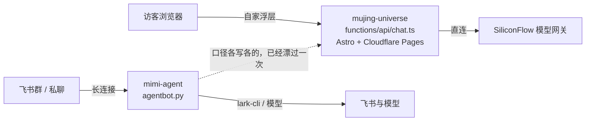

# 多入口对照与方案

调研日期：2026-11-04。这一页回答一件事：官网浮层里的 Mimi 和飞书群里的 Mimi，能不能收到同一个脑子底下，怎么做。

结论先说：能，但不是把两个运行时并成一个进程。按成熟案例的分层，先做到「一处真相」，再加一条「只进不出」的接待桥；浏览器入口该由谁守，还是由官网那侧守着。三步里前两步和接待桥已经落进仓库，剩下一步写在文末，没有做。

外面这些项目的做法，全部来自实际打开过的官方文档或仓库源码，链接在每一小节末尾。有一处没找到明写：LangBot 文档没有说 Web Page Bot 用的什么传输，得看它的源码才知道是 WebSocket，这种情况在文中直说。

## 我们现在是什么样

两个 Mimi，各自独立，谁也不知道谁存在。



左边那套是官网的：提示词、禁词、限流、`[[COOP]]` 交接全写死在 `functions/api/chat.ts` 里，509 行，一个函数干完鉴权、限流、拼提示词、剥标记。它没有会话记忆，刷新就没了。

右边那套是本仓库：核心在 `agentbot.py`，耳朵和嘴在 `channels/`，脱敏和红线在 `guard.py`，写入要白名单加 6 位确认码，主动出门的三条道是早晨摘要 `digest`、播报 `broadcast`、用量周报 `report`，都是到点自己发。

漂过的证据就一条：官网提示词里写着开源模板地址是 `https://github.com/endtree-FDE/feishu-group-agent`。仓库已改名 `mimi-agent`，旧地址 301 跳新地址，链接没坏，但访客听到的介绍落后于事实。这件事写在 [对外口径.md](对外口径.md)。

## 成熟案例怎么做多入口

三个项目，三种分层，共同点很一致：核心只认一套归一化消息，入口的差异留在入口。

### LangBot：一个平台适配层，两种对外形态

Web Page Bot 是「把机器人嵌到别人页面上」。页面里加一段脚本，地址带机器人的 uuid：

```html
<script data-title="LangBot" src="http://localhost:5300/api/v1/embed/<bot_uuid>"></script>
```

服务端 `GET /api/v1/embed/{bot_uuid}/widget.js` 吐浮层脚本，聊天走 **Quart WebSocket** `/api/v1/embed/<bot_uuid>/ws/connect`，历史走 `GET /<bot_uuid>/messages/<session_type>`。这一条文档没写传输方式，是从 `groups/pipelines/embed.py` 和 `sources/web_page_bot_adapter.py` 读出来的。

三个设计点值得抄：

- 嵌入路由是 `auth_type=AuthType.NONE`——浏览器里不可能藏密钥，它索性不装。人机验证靠可选的 Cloudflare Turnstile，把 `{ts}.{hmac}` 当作 WebSocket 的第一帧 `authenticate` 发上去。身份问题交给一个第三方签发的小凭据，自己不做账号体系。
- 连接数有硬上限：全局默认 1024，单个工作区 32，超了回 429。面向公网的入口，先按「会被很多人同时打开」设计。
- HTTP Bot 是另一种形态：调用方 `POST /bots/<bot_uuid>`，HMAC-SHA256 签请求体，头是 `X-LB-Timestamp` 和 `X-LB-Signature`，时间窗 ±300 秒；重复的幂等键回 409，超过 1 MiB 回 413，收到就立即回 202，结果用签名回调送回。最关键的一句是防 SSRF：**回调地址只能来自配置，不接受请求里给的地址**。会话 id 由调用方提供，平台不管你是谁，只保证同一个 `session_id` 落进同一个会话。

它的适配器抽象边界写在 workshop 文档里：适配器负责把平台事件翻成归一化消息、把归一化消息翻成平台发送，别的都不管。

来源：[Web Page Bot 文档](https://langbot.app/docs/zh/usage/platforms/webpage.md)、[HTTP Bot 文档](https://langbot.app/docs/zh/usage/platforms/http-bot.md)、[平台适配器开发指南](https://langbot.app/docs/zh/workshop/impl-platform-adapter.md)、[embed 路由源码](https://raw.githubusercontent.com/langbot-app/LangBot/master/src/langbot/pkg/api/http/controller/groups/pipelines/embed.py)、[web_page_bot_adapter.py](https://raw.githubusercontent.com/langbot-app/LangBot/master/src/langbot/pkg/platform/sources/web_page_bot_adapter.py)。它的平台列表里确实同时有 Web Page Bot 和 HTTP Bot（[仓库 wiki](https://github.com/langbot-app/LangBot/wiki/zh-articles-langbot-telegram-sandbox-agent)）。

### AstrBot：适配器只声明两个能力位，webchat 不自建服务

适配器必须实现 `run()` 和 `meta()`，可以覆写 `send_by_session()`、`terminate()`、`commit_event()`，用 `@register_platform_adapter` 注册进平台管理器。`PlatformMetadata` 里跟多入口有关的是两个布尔位：`support_streaming_message`、`support_proactive_message`——能不能流式、能不能主动推，缺了就把这一格降级，不假装做成了。

会话键是全平台统一的一行：`f"{platform_id}:{message_type}:{session_id}"`，代码里叫 `unified_msg_origin`。webchat 的 id 形如 `webchat!{username}!{cid}`。跨入口的「同一个人 / 同一个会话」就是靠这个组合键解决的，不需要一个全局用户系统。

对我们最有用的一件事：**webchat 适配器自己不启服务**。它复用 WebUI 那个 FastAPI 应用，答复用 `StreamingResponse(media_type="text/event-stream")` 走 SSE 推回去，路由外面套 `require_chat_scope` 鉴权。也就是说浏览器入口被当成「WebUI 的一个页面」，不是「一个新平台的服务」。同一份文档没写的是安全边界：WebUI 默认绑 `0.0.0.0:6185`——默认对局域网开放，靠登录态守门。

来源：[platform.py](https://raw.githubusercontent.com/AstrBotDevs/AstrBot/master/astrbot/core/platform/platform.py)、[webchat_adapter.py](https://raw.githubusercontent.com/AstrBotDevs/AstrBot/master/astrbot/core/platform/sources/webchat/webchat_adapter.py)、[dashboard/api/chat.py](https://raw.githubusercontent.com/AstrBotDevs/AstrBot/master/astrbot/dashboard/api/chat.py)、[dashboard/server.py](https://raw.githubusercontent.com/AstrBotDevs/AstrBot/master/astrbot/dashboard/server.py)、[message_session.py](https://raw.githubusercontent.com/AstrBotDevs/AstrBot/master/astrbot/core/platform/message_session.py)。

### NoneBot2：传输和能力位拆成 driver 与 mixin

NoneBot2 把「怎么收发」叫 driver，分两类：Forward（我作为客户端出去）和 Reverse（我作为服务端等人进来，含 WebHook 和反向 WebSocket 客户端）。声明方式是语法 `<module>[:<Driver>][+<module>[:<Mixin>]]*`，能力按 Mixin 叠加（HTTPClient / HTTPServer / WebSocketClient / WebSocketServer）。配置里**服务端类型的 driver 最多一个**。内置可选 `~fastapi`（ASGI，默认）、`~quart`、`~aiohttp`、`~httpx`、`~websockets`、`~none`。

适配器不碰端口，只做翻译：用 `driver.register_adapter()` 把自己挂上 driver，收事件的回调通过 `HTTPServerSetup` / `WebSocketServerSetup` 挂到那个唯一的服务端上。**传输归 driver，协议归 adapter**——这句话是多入口最干净的分工。

权限那一层的分工也值得记住：核心 `nonebot.permission` 只有 USER / SUPERUSER / Message / Notice / Request / MetaEvent，`PRIVATE`、`GROUP`、`GROUP_OWNER` 这些是各家 adapter 自己定义的。身份语义属于入口，不属于核心。会话同理，`get_session_id()` 的说明是「通常为机器人用户 ID 与群聊/频道 ID 组合而成」。

来源：[driver 文档](https://nonebot.dev/docs/advanced/driver)、[adapter 文档](https://nonebot.dev/docs/advanced/adapter)、[适配器编写指南](https://nonebot.dev/docs/developer/adapter-writing)、[permission API](https://nonebot.dev/docs/api/permission)、[onebot v11 permission.py](https://raw.githubusercontent.com/nonebot/adapter-onebot/master/nonebot/adapters/onebot/v11/permission.py)。

## 三家和我们，同一张表

| 分层 | LangBot | AstrBot | NoneBot2 | 本仓库 |
|---|---|---|---|---|
| 核心只认归一化事件 | 平台适配层 | `Message` | `Event` | 有：`channels/base.py` 的事件结构，`agentbot.py` 不认识 lark-cli |
| 能力位 / 缺就降级 | 平台 config 项 | `PlatformMetadata` 两个布尔位 | Mixin | 有：`Cap.*` 16 项、`TOOL_CAPS`、`_UNAVAILABLE` 一句人话 |
| 入站传输（浏览器可达） | 自建 HTTP + WebSocket 服务 | 复用 WebUI 的 FastAPI，SSE | 唯一的 Reverse driver（ASGI） | **没有**。全仓库没有一个服务端监听，只有长连接出去 |
| 会话键跨入口 | HTTP Bot 由调用方给 `session_id` | `platform_id:message_type:session_id` | `get_session_id()` 组 id | 按 `chat_id` / `sender_id`，只在飞书语义内 |
| 对外鉴权 | 嵌入路由不装鉴权 + 可选 Turnstile；HTTP Bot HMAC 签名 | `require_chat_scope` 登录态 | 归 adapter | 只有「谁能在飞书里说话」：`p2p_can_reply` / `p2p_limited` |
| 公网配额 | 连接数上限，超额 429 | 未文档化 | 未文档化 | 只有单人/每小时限流，面向群成员，不是面向访客 |
| 主动推送 | 平台侧 | `support_proactive_message` | 归 adapter | 有：`digest` / `broadcast` / `report` 三条定时出口 |
| 从外部收数据 | 平台事件 | 平台事件 | 平台事件 | 新加一条：`intake.py` 到点出去拉，只写文件不发消息 |

## 我们已经有什么，别重复造

`channels/base.py` 把 16 项能力列成 `Cap` 常量，`TOOL_CAPS` 把模型工具名映射到需要的能力，`_UNAVAILABLE` 给每项缺能力时的一句人话。这套东西的用途正是三家说的同一件事：**新入口缺哪一格，就在哪一格降级，不许假装成功**。企业微信骨架 `channels/wecom.py` 已经按这个契约实现过一次（不连接，只声明能力），说明这层抽象不是纸上的。

`p2p_can_reply()` 和 `p2p_limited()`（`agentbot.py` 第 836、843 行）是访客档：私聊对所有人开放时，不在名单里的人能聊天，但用不了飞书工具和技能。这就是 NoneBot2 说的「身份语义属于入口」，我们已经有了入口级的权限分层，只是它只有「熟人 / 生人」两档，没有「公网匿名访客」这一档。

出口侧的护栏是现成的，接待桥直接复用：`guard.safe_path` 拒绝对盘符和 `..`，`guard.redact` 打码客户名和手机号，`guard.neutralize` 把 `<<tool>>` 这类标记改成全角占位，`acp_client._public_http_url` 拒绝非 http(s)、带 userinfo、超长主机名、控制字符和内网地址。真正连出去之前还有第二道：`broadcast._http_get` 用 `acp_client._public_addrs` 把域名再解析一遍，两次结果不一致、或解析结果落在内网，就不连。`digest.outbound_lock` 那把锁保证同一时刻只有一段代码在出门。

## 缺什么，按成熟案例的口径说清

一、**没有浏览器可达的入站传输。** 这不是漏写，是这台机器的物理限制：只有出去的长连接，没有能对公网开放的端口。三家都假设有（或复用）一个 Web 服务；我们没有，所以任何「官网把访客的话送到飞书这边」的想法都必须走出去的这一侧——这就是 `intake.py` 做成拉取而不是推送的原因。

二、**没有跨入口的会话键抽象。** AstrBot 用 `platform_id:message_type:session_id` 一行解决，我们按 `chat_id` 分记忆，官网那侧根本没有会话持久化。要做「同一个访客在两边接着聊」，先得有这样一个组合键，且明确它是本地 id，不外传。

三、**没有面向调用者的配额。** LangBot 对嵌入入口给的是全局 1024 / 单工作区 32 / 429；我们的限流假设「群里十个人」，量级差三个数量级。接待桥不需要它（拉的是自己写的文件），但真做入站就必须补。

四、**没有浏览器侧的身份与凭据。** LangBot 的选择是不装鉴权、把人机验证外包给 Turnstile，因为「脚本里放密钥」本来就是假安全。我们如果将来要接，也应该照这个顺序：公开入口 + 第三方签发的小凭据，而不是给访客发 token。

## 对外入口的边界与失败模式

这一节是把「如果做入站会怎么坏」逐条落到现有代码上，每条都写明现在谁在守。

| 会怎么坏 | 现实路径 | 现在谁在守 |
|---|---|---|
| SSRF：让服务器去访问内网 | 请求里带回调地址 / 拉取地址由外部给 | LangBot 靠「回调地址只从配置读」；我们靠 `url` 只写在实例配置里，`intake._url_ok` 先用 `_public_http_url` 判形状和内网，真连之前 `_http_get` 还要两次解析结果一致、且都不是内网才连 |
| 请求头注入 | 访客文本拼进 header | `broadcast._http_get` 见到 `\r\n\t\x00` 直接 `blocked`，连都不连；`intake._headers` 先查环境变量里的 token |
| 访客话里的提示词注入 | 「忽略以上指令」进上下文 | `guard.neutralize` 吃掉 `<<tool>>` 这类标记；注意 colon 形式 `<<TOOL:name>>` 不在 `_MARK` 的匹配里，这一格没守住 |
| 泄密：客户名、手机号、保密项目名 | 出站的正文 | `guard.redact` 在出口统一打码；官网侧另有禁词正则整条替换 |
| 密钥外流 | 写进配置、写进日志、进正文 | `token_env` 只记变量名不记值；`guard.embeds_secret` 判定含密钥的条目直接丢弃；`--check` 的 HINT 会喊 |
| 超量：一个访客刷爆额度 | 无限拉、无限写 | 单次正文上限 4096 字节、一条最多 20 项、最短间隔 15 分钟；写不进就退默认路径 |
| 并发写坏文件 | 两段代码同时写同一个文件 | `digest.outbound_lock` 5 秒耐心；拉取的网络等待不占锁，拿不到锁就记 `busy` 本轮不做 |
| 幂等：同一意向播报两次 | 端点重复返回 | `state/intake_state.json` 按 id（没有 id 就用正文哈希）去重，留最近 500 条 |
| 时区把「次日」算错 | Windows 上没有 tzdata | `digest.zone` 的固定偏移兜底；`intake` 复用同一个函数，未知时区名就不拉 |
| 训练数据被污染 | 陌生访客的话进知识库 | 接待桥只写 `intake/leads.md`，那个文件在 `.gitignore` 里，不进知识库、不进记忆 |
| 误发：把待审正文当已审发出去 | 自动挂上播报 | 必须人复制进 `broadcast/pending.txt`；`--dry-run`、`--check`、`--doctor` 一律不发，测试用假发送落点证明了三个文件都不生成 |

失败模式里唯一还开着的一格是 `<<TOOL:name>>`。它是官网 `[[COOP]]` / `[[FARM:...]]` 那种标记的近亲，但 `guard` 的标记正则不认带冒号的写法。这一版没有改 `guard.py` 的匹配范围——动它会影响所有出站正文的判定，超出这次三步的范围。记在这儿，等下一次专门处理。

## 结论与建议

一、**不要把两个运行时并成一个进程。** 官网那套的价值是零后端、Edge 就近、无状态、刷新即匿名；这套的价值是长连接、工具、确认码、记忆。合并会立刻引入我们没有的那三样东西（公网监听、访客配额、浏览器鉴权），换来的只是「代码少一份」。三家成熟项目都没这么合并——它们合并的是抽象层，不是进程。

二、**要合并的是口径，一处真相。** 已经落进仓库：`docs/对外口径.md`（现 `voice-v2`，2026-11-05），作品清单与路径、口吻与风格锚、保密期不复述名字、禁词、不报价不承诺档期、成员身份不介绍、`[[COOP]]` 出名片和 `[[LEAD]]` 出「把这几句发给团队」的按钮，全在里面，并记录了旧仓库名 301 但口径落后这件事。这一版是**人复制引用**，不是运行时抓取——因为「取不到怎么办」和「版本号怎么对齐」这两件事要先定，先猜一个降级策略会把官网的可用性绑到本仓库的发布节奏上。下一步才是让机器人启动时读它、官网构建时从它生成 `SYSTEM` 的常量部分。

三、**方向相反的桥先只开一条：只进不出。** 已落地成 `intake.py`。按 LangBot HTTP Bot 的形状看，它其实就是那个签名调用的反面：调用方是自家官网，凭据在自己环境变量里，数据落在自己文件里，最后一步由人点头。它不调模型、不读日历、不写飞书，攒下的东西走现成的播报 `body_file` 通道进群。默认关，发不发由人决定。这一条最符合成熟案例的分工：入口的差异留在入口，核心一个字不改。

下一跳（`intake_notify.py`，同样默认关）补的是「到飞书里的人」：待审文件攒了新东西时私聊主人一条带 6 位码的提醒，主人在同一条私聊里回 `发意向 123456` 才进群，回 `不发意向 123456` 只记账。接待桥本体依旧一个字节都不发——它内部仍然没有发送通路，这条测试断言写死在 `tests/test_intake_notify.py` 里。原来那条人抄 `broadcast/pending.txt` 的路留着，两条不冲突。

四、**如果将来真要做浏览器直连的入口**，照这个顺序抄：AstrBot 的组合会话键 → LangBot 的「嵌入路由不装鉴权 + 第三方人机凭据 + 连接数上限回 429」→ NoneBot2 的「传输归 driver、协议归 adapter、服务端 driver 只有一个」。落到本仓库就是一个新的 `channels/` 适配器加一个可选的服务端开关，默认关。不要在 `agentbot.py` 里加 `if http:` 分支。

五、**官网侧的改动只出 patch。** 现在是四份改动、五个文件，落在三个 patch 文件里，都在 `v3-upgrade-work/site-bridge-20261105/`，都重做到 `ac22187` 上、`git apply --check` 在干净克隆和当时的仓库工作树都只读验过，三份叠在一起贴也不冲突（「当时」这个底后面动过，见紧跟着那句更正）。**更正**（2026-11-05 10:58 重测）：先前这句写的是「她当前那 11 个未提交文件的工作树」，那个底已经过去了——丽丽自己又提交了几个 commit，站点本地 HEAD 现在是 `24e8bff`（比 `origin/main` 领先 3 个提交，未跟踪文件 0，未提交的只剩 3 个：`ChickenFarm.astro`、`coop/coop.js`、`coop/pack.json`，都是她鸡场那条线的，跟这三份 patch 改的文件不重叠）。当场在她的工作树上按 `git apply --check` 重跑一遍（只读，不落盘，退出码逐条抓）：`bridge-20261105.patch`、`mimi-core-lead-20261105.patch`、`mimi-chat-lead-20261105.patch` 三份各自 rc=0，三份叠在一起也 rc=0；那份留着对读用的旧 `chat.patch` 同样 rc=0，但它已被 `bridge-20261105.patch` 覆盖（同一批 `chat.ts` 改动 + 新建 `leads.ts`），**别和第一份一起贴**。
  - **再更正**（2026-11-05 11:15，隔 17 分钟底又动了一次）：她那 3 个未提交文件被她自己提交成了 `1ca55e6`（feat/chicken-farm-map「地图四件配套」），站点工作树当场数 `git status --porcelain` = 0 行、干净；本地 HEAD 从 `24e8bff` 走到 `1ca55e6`，比 GitHub 上的 `origin/main`（`740c58b`）领先 4 个提交。顺手核了一件会影响「贴哪儿」的事：`git merge-base --is-ancestor 740c58b 24e8bff` 退 0，说明她本地 `main` 已经包住 GitHub 那份，patch 在她本地 `main` 上验过就等于在上游内容上验过。在新底上重跑只读校验（退出码逐条抓，不走管道尾巴）：三份各自 rc=0、`chat.patch` rc=0、三份叠贴 rc=0；另外从一个只读临时克隆里对她本地 `main`（`24e8bff`）也验了一遍，同样三份 rc=0，跑完即删，没碰她的工作树。**结论没变，变的是底**：这一页里所有「当前 HEAD」「N 个未提交」都只是读数时刻的值，隔十几分钟就可能旧——要给丽丽的话，让她在自己那边现跑一次 `git apply --check`，别引用这里写的数。
- `bridge-20261105.patch`：给 `functions/api/chat.ts` 的 8 处（口径来源注释、`[[LEAD]]` 交接标记与剥除、收尾帧多带一个 `lead`），和新建 `functions/api/leads.ts`（`POST` 收访客意向进 KV、`GET` 只认 `Authorization: Bearer` 给机器人拉，返回 `{"leads":[...]}`，形状与 `intake.parse_body` 对得上）。
- `mimi-core-lead-20261105.patch`：给浏览器侧协议 `src/scripts/mimi-core.js` 的 12 处。只贴上一份的话，服务端下发的 `lead: true` 浏览器根本不读，`[[LEAD]]` 会以方括号裸字出现在页面上；这一份补的就是那一跳。配 17 条纯内存探针（`probe-core.mjs`，假 fetch）：底稿 FAIL 16，改后 FAIL 0。
- `mimi-chat-lead-20261105.patch`：新建 `src/scripts/mimi-lead.js`（102 行）加 `src/components/MimiChat.astro` 的 5 处接线。前两份只让页面「知道有这条意向」，按钮本体（三格 + 发送 + 失败话术）一直没人生过——第 1 跳缺的就是这一格。卡片只搬模型复述里带标签的原文，认不到留空，点一下才 `POST /api/leads`，一次点击只发一次。配 27 条假 DOM 探针（`lead/probe-lead.mjs`）：底稿 FAIL 1（模块不存在，后面全跑不起来），改后 FAIL 0。

那个仓库属于 `LiliLIN0324`，未经确认不代改、不代提交、不部署。

## 链路验收矩阵

一句话：每一跳写清「看什么能算通」「现在通到哪一步」「缺谁点头」。全表没有发过一条真实消息，也没有碰过线上实例。

**这句红线本身怎么查**（2026-11-05 17:46，全程只读，脚本 `v3-upgrade-work/site-bridge-20261105/redline_check.py`，读数存 `redline-1749.txt`；判据按代码挑不是猜词）：真实出门那一条在 `outbound.py:76`，走 `lark-cli im +messages-send`。取到的证据——① 三台 `logs/bot.log` 里 `messages-send` 计数 `mumu / mimi / lingbo = 0 / 0 / 0`；② 出门记账的 `audit/*.jsonl` 最后写入时间分别是 `mumu 2026-11-02 23:15:09`、`mimi 2026-10-19 08:02:20`、`lingbo 2026-10-17 16:31:59`，都在今天之前。配置侧：`agents/*.json` 的 mtime 最新只到 `mumu 2026-11-03 01:46`（`config.schema.json`，仓库自带那份），`mumu.json` 停在 2026-10-21 00:11、`mimi.json` 停在 2026-10-28 22:41、`lingbo.json` 停在 2026-10-21 00:19；三台都没有 `intake*.py`，和「三个前置」第一条一致。**有一条判据当场作废，记在这儿**：我原本还想查「正文临时文件 `out_<hash>.json` 今天有没有多出几个」，数出来三台都是 0——但任意日期也都是 0，因为那个目录是 `channels/feishu.py:80` 从外面传进来的 `self.tmp`，不保证在实例目录下（这次没往上追），所以**这一条证不出任何事，不能算证据**，删掉它对上面结论没影响。判据的边界也说清：`bot.log` 查不到那个词只说明这日志不记那条命令行，真正钉住「没发」的是 audit 最后写入早于今天。

下面这张表的「现在」全是离线跑出来的，最近一次整链重跑是 **2026-11-05 18:38**（底还是她当前的 `a2d1025`（16:52 那一提交），但她工作树这次有 **8** 个未提交文件——13:58 那趟读的是 1 个，别把任何一处的「N 个未提交」当现值；记录 `runall-1838.txt`，十四步一次过、最后打 `ALL_SITE_CHECKS_OK`，数与 17:45 那趟一致；单跑校验那一步的原件是 `pv-1840.txt`：`底已换成丽丽仓库当前 HEAD a2d1025`、`她工作树未提交文件数=8`、三份逐份和叠贴 `--check` 全 rc=0、`RESULT ALL3_OK`；跑完临时克隆 `verify/` 是 0 个脏文件，另一份 13:48 遗留的 `clone/`（旧底 `ac22187`，还带着上次贴进去的两个文件）也在 18:40 还原成 0 个脏文件，并在 `patch-on-main.txt` 里写明它是旧底——13:58 正因为没重取底而把旧判据当有效结论用过一次）。上一次是 **17:45**（底是她当前的 `a2d1025`，工作树 0 个未提交；记录 `runall-1745.txt`，数与 14:10 那趟一致：叠贴那步 `RESULT ALL3_OK`、`takeVisible` 12/12、缺件路径 12/12、协议层改后 FAIL 0 且底稿 FAIL 16、卡片 27/27、真 socket 15/15、反向闸 0 处认错）；上一次是 **14:10**（底 `1ca55e6`）：`v3-upgrade-work/site-bridge-20261105/run_all.py` 十四步一次过（三份 patch 叠贴 + 还原 rc=0、口径与提示词对读 SAME、`takeVisible` 12/12、**缺件路径 12/12**（第 5 步，见第 2 跳那一格）、协议层 17 条 FAIL 0（底稿那条应当红，FAIL 16 才算过）、假 DOM 卡片 27/27、真 socket 15/15、第 3-5 跳 `pull=polled blocks=1 notify=notified`、第 1→5 跳同一份数据 9/9、反向闸 `0 处认错`），最后打 `ALL_SITE_CHECKS_OK`（`runall-1410.txt`；和 13:59 那趟 `runall-1359.txt` 数完全一样，只多把叠贴那一步的名字从「逐字节比对」改成「判据两道(逐字节/加行)」——名字得和它现在真做的判据对上，光改文档不算）。**这一趟换底重跑过一次，原因记在这儿不抹**：贴 patch 那步的临时克隆一直钉在旧底 `ac22187` 上，而丽丽 11:15 之后又提交了 4 个（现在 `1ca55e6`），其中两个动了 `functions/api/chat.ts` 和 `src/components/MimiChat.astro`（她自己加了 `[[FARM:event]]`）——所以 13:51 那趟虽然也打 `ALL3_OK`，验的其实是旧底，而旧底上那句「五个文件和我的副本逐字节一致」已经不再是有效判据。13:58 把校验脚本改成每次先 `git fetch` 她仓库的当前 `HEAD` 再 detach 过去（只读她的仓库，工作树一个字没动），判据拆两道：两个新建文件仍逐字节比（`leads.ts`、`mimi-lead.js` 都 SAME），三个改动文件改验「patch 自己新增的那几行原样在场」，这次 `30/30`、`159/159`、`33/33`、`72/72`、`102/102` 共 396 行全在场；顺手在她工作树上只跑 `--check`（不落盘），她现在有 1 个未提交文件（`src/lib/coop/coop.js`，+92/−55，不在这五份里），三份逐份和叠贴都 rc=0。**18:40 再数一次：她那侧 8 个未提交文件，三份逐份和叠贴仍全部 rc=0（`pv-1840.txt`）**；上面那个「1 个」只是 13:58 那一趟的读数，别当现值。上一次整链重跑是 13:59，再往前是 13:10 和 11:14（那趟还是十三步，尚无缺件那一步），数都一样。仓库侧 `tests/run_tests.py` 471/471 在 UTF-8 和 cp936 两种编码下都过——按当前这棵树（`8cafd7f`）落定的那趟是 13:56 起的：UTF-8 到 14:02、cp936 到 14:07，两边都是 `471/471 passed` 且退 0，接待桥那一格两边 `43/43`（`rt15-utf8.txt` / `rt15-cp936.txt`）；这一页之后又动过几句文档，那一版另起一趟两种编码重跑，读数写在 CHANGELOG 的 `[Unreleased]` 里。**14:37/14:51 那趟换了分母**：闸自己修了一次（`tests/run_tests.py` 那条 `timeout=240` 原来没人接异常，任何一条子进程慢过上限就整串没有汇总——12:05 的 cp936 就是这么跑丢的），新增 `tests/harness.py` + `tests/test_harness.py` 和一格 `-- harness --`，所以 `471` 变 `472`；修完两种编码各整跑一遍都是 `472/472 passed` 且退 0（`rt18-utf8.txt` / `rt18-cp936.txt`），旧的 `471` 那几行留在上面当它们那棵树的读数。这一棵已经推到上游（`docs/entry-census` 上的 `39995cc`，四条必需检查 15:05 全绿，`gh run view` 的日志里 ubuntu 和 windows 两台都打出 `472/472 passed`）；**守卫那一棵 `55c339e` 也于 17:56 四条必需检查全绿**（`ci-watch-89h.txt` 最后一行 `ALL_GREEN head=55c339e merge=BLOCKED`，`gh run list` 里对应 `42004796325 success`）——这一条我只按必需检查的状态下的结论，**那两台的 `472/472` 日志文本这次没去抓**，因为本地整套正在跑、下载全量日志的磁盘和网络 I/O 有可能把某条子进程拖慢；等本地这趟落定再补那一条（没补之前别把它当已验）。`origin/main` 还停在 `63b7cd0`，落不落进 `main` 由主人定，见「三个不在代码里的前置」那一条。

**上面那句「日志文本没抓」19:00 起补上了，同时换了新的一棵**（2026-11-05 18:43–19:00，原件 `ci-watch-89i.txt`、`rt27-driver.txt`）。先落本地：闸那一棵 `84abc43` 之上只有文档改动的这一版，`checks/lint.py` 退 0（85 个 Python 文件可编译），`tests/run_tests.py` 两种编码各整跑一遍都是 `473/473 passed` 且退 0，两边 `^FAIL ` 行数都是 **0**（UTF-8 `rt27-utf8.txt`、cp936 `rt27-cp936.txt`，18:44 起、19:00 落定）——这一条正是上面那条「作废」用的那把尺，现在它自己也过了自己那道判据。再落上游：`84abc43` 四条必需检查 **18:48 全绿**（`ci-watch-89i.txt` 最后一行 `ALL_GREEN head=84abc43 merge=BLOCKED`，`secret scan` / `test (ubuntu-latest)` / `Windows PowerShell 5.1` / `test (windows-latest)` 逐一 `pass`）。`merge` 仍是 `BLOCKED`，和 `55c339e` 那一棵一样——不进 `main` 要主人点头，见上一条。

**上面欠的那句「日志文本没抓」现在补了，而且它顺手把这次修的毛病在上游也钉死了**（19:01 抓，原件 `ci-log-55c339e.txt`、`ci-log-84abc43.txt`、`runtree-42004796325.log`、`runtree-42012330197.log`）：`55c339e` 那一趟（`42004796325`，UTC 09:47–09:56）三台四个跑次里 `472/472 passed` 各打了一次，可同一批日志里数得出 **8 行** `FAIL dedup` / `FAIL 超时：y.jsonl`（ubuntu、windows 的 UTF-8 与非 UTF-8 两个跑次、PS 5.1 各 2 行）——也就是说那几行假失败不止在我本地漂，CI 上一样漂，而四台都照样报全绿退 0，没有一处判据拦得住。`84abc43` 那一趟（`42012330197`，UTC 10:41–10:50）同样的数法得到 **0 行**，`473/473 passed` 在 ubuntu、windows（UTF-8 与非 UTF-8 两个跑次）和 PS 5.1 各打一次，闸那一格从 `11/11` 变 `16/16`、接待桥那一格 `43/43` 变 `46/46`。两边对照能看出这次的改动确实是被验的：不是「日志变漂亮了」，是那两行不再由探针打到 stdout 上。**这一版有一处诚实的口径要写明白**：`rt27` 那趟之后这一页和 `CHANGELOG` 又长了上面这几段字，所以「`473/473` 是在这一版上跑出来的」只对 `rt27` 当时的树成立。断这个循环的办法是把**最后一趟**的读数写进提交说明而不是写进这棵树——写进树里，树就永远比被测时多一行；提交说明不进这棵树，测的是它、写的也是它。所以推上去的这一棵落闸的数是**落在提交说明里那一趟**，而 CI 那几台又在那一棵上整跑一遍。**以前几轮没写这句限制，等于默认它不存在。**

**「日志干净」这一句在这一页里作废**（2026-11-05 18:02 起，18:36 落定）。15:03 那层超时守卫（`tests/harness.py`）在子进程慢过了会往自己的 stdout 印一行 `FAIL <名字>`，而 `tests/test_harness.py` 里几条内部探针验的恰恰就是「它印不印得出名字」，于是那几行直接混进整套日志。按文件数过：`rt18-utf8.txt` 混 1 行，`rt20-utf8.txt` 和 `rt20-cp936.txt` 各混 2 行（`FAIL dedup`、`FAIL 超时：y.jsonl`），可那三趟都报 `472/472 passed` 并退 0；被我中途停掉的 `rt22-utf8.txt` 第 379、384 行留的就是那两行原件。所以凡是按「印出的 FAIL 与计数对齐 / 输出干净」在那几趟上下过的结论都不算数。这不是排版：读日志的人会把假失败当成上一轮没落干净，反过来真失败混在里面也看不出来——闸自己说谎，和闸碎掉是同一类毛病。

改法两步，都先红后绿。一、`tests/test_harness.py` 把那两处探针的调用兜进 `contextlib.redirect_stdout(io.StringIO())`，判据改成「那行 `FAIL` 落在缓冲里」——「名字印得出」这件事仍然有测试钉着（第 5 条本来就是跨进程 `capture_output` 的，没动）。二、`tests/run_tests.py` 的 `-- harness --` 那一格加一条外层判据：闸自己那趟印出的 `FAIL` 行数必须等于它那句 `N/M passed` 里的 `M-N`，那句汇总拿不到（超时或半路崩）也算这条没过，因为那时日志根本对不上号。判据的红是先看过的：`v3-upgrade-work/site-bridge-20261105/harness-fail-probe.py` 算的就是这一格现在算的那几样，改之前 `rc=0`、`11/11 passed`、`FAIL` 行 2 条 → False（`PROBE_RC=1`），改之后 `13/13`、0 条 → True。

同一把尺 18:16 又捞出闸里最后一处没包到的自毁路径：整套除了一大片带 `timeout` 的 `subprocess.run`，还有一处自己 `Popen` 完再 `p.wait(timeout=30)`（「两个进程同时记跟踪」那条，`tests/run_tests.py:711`），守卫那层包的是 `subprocess.run`，包不到它；机器慢过那 30 秒抛出去的还是一个没人接的 `TimeoutExpired`，traceback 一穿，汇总就又没了。新写的两条判据在没有 `harness.wait_all` 的树上是 `13/15` 退 1（detail 里就是那句 `AttributeError: module 'harness' has no attribute 'wait_all'`）；第一版实现转成 `14/15`，红的那条抓到的是我自己写歪的地方——一批两个进程各挂一次就记两条、印两行一模一样的名字，那是把人往「两个不同的失败」上带，改成一批只记一条、退出码仍逐个交回非 0。随后补的那条「没慢过的那一批要原样交回真实退出码」也按变异验过：只验超时那一边的闸是空闸，把实现临时改成无论怎样都回 `-1`，前两条超时判据照样绿、而套件里那句「退出码都是 0」会永远红，这一改只有新那条红（`15/16`），按原字节还原后 `16/16`（`waitall-red.txt` / `waitall-green.txt` 留在底稿目录）。

这一轮落定的整树读数（底 `55c339e`，工作树里动的只有 `tests/harness.py`、`tests/test_harness.py`、`tests/run_tests.py` 那一格与那个调用点、`tests/test_intake.py` 那段契约、`CHANGELOG.md` 与这一页）：`checks/lint.py` ok（85 个 Python 文件可编译）；整套两种编码各整跑一遍，UTF-8 `473/473 passed` 退 0（`rt24-utf8.txt`，`^FAIL ` 行数 0），cp936 `473/473 passed` 退 0（`rt25-cp936.txt`，`^FAIL ` 行数 0），中间那一格现在是 `16/16 passed`、外层那条新判据 PASS。外层分母从 `472` 变 `473` 就是这一格多出来的那条判据（`wait_all` 只在真慢过时才多记一条）。`rt23-utf8.txt`（`473/473`、0 行 `FAIL`）是同一棵树补 `wait_all` 之前那一趟，两条都留着不抹，因为它们的树不同。那个 30 秒的 Popen 上限这一轮没有真慢过、也就没在线上量过，它是代码里的常数，别当实测。

| 跳 | 看什么算通 | 现在 | 缺谁点头 |
|---|---|---|---|
| 1 访客在官网留下意向 | 预览环境点一次「把这几句发给团队」，`POST /api/leads` 回 202，KV 里多一条 `lead:<id>` | **代码就绪，未落地**。`leads.ts` 用站点自己的 TypeScript 5.9.3 `--strict` 编译过；`takeVisible` 的 12 个用例（含标记拆两个分片、只剩半个前缀）跑过；浏览器侧认 `lead` 的那 12 处另有 17 条内存探针（底稿 FAIL 16 → 改后 FAIL 0）；03:59 补上按钮本体那一份（`mimi-lead.js` + `MimiChat.astro` 5 处接线），27 条假 DOM 探针改后全绿；04:19 再补一条真 socket 的（`site-bridge-20261105/e2e/e2e-socket.mjs`，15/15）：打过 patch 的卡片用真 `fetch` POST 进编译出来的 `onRequest`，再带 Bearer 取回，`need/when/note` 一字不差——这一条不写字面量，直接拿卡片上那三格（两个 `input` 加一个 `textarea`）的当前值来比 | 丽丽：审 `bridge-20261105.patch` + `mimi-core-lead-20261105.patch` + `mimi-chat-lead-20261105.patch` 并决定贴不贴、部不部署。三份在她的工作树上只读验过能干净贴上，她那侧一个字节都没动；底已重测过三次：10:58 那次是 `24e8bff` + 她那 3 个未提交文件，11:15 那次她已经把 3 个提交成 `1ca55e6`、工作树干净，**13:48 又换了一个底重验**——她本地那条 `feat/chicken-farm-map` 比 GitHub 的 `origin/main`（`740c58b`）领先 4 个提交，而这 4 个提交里正好动了 `functions/api/chat.ts` 和 `src/components/MimiChat.astro`（第一、三份 patch 也动这两个文件），所以她一旦切回 `main` 再贴，底就不是原来那个了；做法是从一个跑完即删的临时克隆里 `git checkout 740c58b`（她的工作树一个字没动），逐份 `--check` 三份 rc=0、按 bridge → core → card 叠贴也全 rc=0、贴完 `functions/api/leads.ts` 与参考件 `cmp` 逐字节一致（159 行），还原后 0 个脏文件（底稿 `v3-upgrade-work/site-bridge-20261105/patch-on-main.txt`）。两份底都贴得干净，她在哪一份上贴都行。**13:58 还纠了自己一处仪表**：贴 patch 那步的临时克隆此前一直钉在旧底 `ac22187`，而她 11:15 后又提交了 4 个（现在 `1ca55e6`），其中动了 `chat.ts` / `MimiChat.astro` 的正是她自己那条 `[[FARM:event]]`——所以「五个文件和我的副本逐字节一致」这句已经不是有效判据；脚本改成每次先 `git fetch` 她仓库当前 `HEAD` 再 detach 过去（仍只读，她工作树一个字没动），判据拆两道：两个新建文件继续逐字节比（都 SAME），三个改动文件改验「patch 新增的那几行原样在场」，13:59 这趟是 `30/30`、`159/159`、`33/33`、`72/72`、`102/102` 共 396 行全在场，和她自己那 6 行 / 4 行的差异互不干扰。顺手在她工作树上只跑 `--check`（不落盘）：她现在有 1 个未提交文件（`src/lib/coop/coop.js`，+92/−55，不在这五份里），三份逐份与叠贴仍 rc=0。**18:40 又在她工作树上只读跑了一遍：她那边现在是 8 个未提交文件，三份逐份与叠贴仍全部 rc=0（`pv-1840.txt`，底 `a2d1025`）**。**引用这里的数不如自己现跑一次 `git apply --check`** |
| 2 意向存在站点侧、能被取走 | Cloudflare Pages 有 KV 绑定 `LEADS` 和 secret `LEAD_TOKEN` | **不通，缺绑定**。仓库里没有 wrangler 配置，也看不到绑定；没有 `LEAD_TOKEN` 时 `GET` 回 501，等于这个口是关着的。**但缺绑定不等于不能先贴代码**（13:10 实测，`chain/no_kv.mjs` 12/12，已进 `run_all.py` 当第 5 步）：`env` 全空、只给 secret、只给 KV 三种缺件组合各打一遍 `onRequest`，六种情况一个抛出的都没有——提交回 `501 {"error":"storage"}`、拉取回 `501 no_token`（意向列表不对公网敞开），缺件那几跑一条也没落进 store，两样配齐才 `202` + `200`。所以丽丽可以先贴 patch、后建绑定，中间那段时间聊天照常，只有按钮拿到 501 | 丽丽或有 Pages 权限的人：建 KV 命名空间 + 加 secret（这一步我们没权限替她做）；**这两项不是贴 patch 的前置，只是这一跳通起来的前置**；**17:55 复核 `leads.ts` 时多出一条要点头的**：拉取那边比对 token 用的是普通 `!==`（第 135 行），不是恒定时间比较。边界说清——钥匙只从 `env.LEAD_TOKEN` 这一个来源来（第 132 行，没有配置或 URL 兜底），没配就整口 501、比不过回 403 且一个字节意向都不带；真要按时间差猜一把长随机串得先绕过限流。这是「可以更强」不是「能被绕过」。改法在 Workers 上是两边各做 `SHA-256` 摘要再比（都定长）或用 `crypto.subtle.timingSafeEqual`（得看她那侧运行时支不支持）。**这一轮没动那个文件**：这一页相关读数（三份叠贴 `--check`、`leads.ts` 逐字节 `cmp`、真 socket 15/15）都在现在这个写法之下跑出来的，改了就得重跑，而且改鉴权要点头；已经写进 `说明.md` 的「没验证 / 缺谁点头」那一节，点一次头我按先红后绿重做并整链重跑 |
| 3 机器人定时来拉 | 日志 `reason=polled`，`intake/leads.md` 多出 `## ` 段落，`state/intake_state.json` 记下编号 | **代码就绪，等 1、2**。已用探针把端点真实返回的那段 JSON 原样喂进 `intake.tick()`：`{'reason': 'polled', 'new': 3}`，落盘 3 条，`<<TOOL>>` 被中和成〈TOOL〉、控制字符折成空格；04:48 起还能改用第 1 跳那次真 socket 取回的那一条做输入（`chain/chain.py ../e2e/e2e-result.json`），`check_socket.py` 9/9 比过——访客填的形式、时间、来源页确实落到待看文件里。**这 9 条判得出假**（05:20 发现自己第一版判不出：那三格抄了另一批探针的措辞，拿 socket 那条去比假输入那批照样 True，等于白比。改法是两边各用互不包含的措辞，再双向比一遍：`chain/negative_check.py` 六格全判不出才算过，`0 处认错`；临时把两边文字换成同款，它立刻 `3 处认错` 退 1，比完按原字节还原） | 你：官网那条链先跑通，再给线上实例写 `intake.enabled: true`。**升级之后不用开开关也有一处可看的**：`--check` 里 `intake.hints` 会逐条说明为什么不会拉（url 不是可连的公网地址——这句真的会去解析域名，测试里用 `AGENTBOT_FAKE_DNS` 桩住；`timezone` 认不出；`token_env` 指向一个空变量），13:17 那趟探针顺带修掉一条假话：`out_file` 写成绝对路径时原先那句「待审文件不会写」永远触发不了（`settings()` 早换成默认路径，文件照写），现在改成点名你原样写的那个路径、说这一版按 `intake/leads.md` 落。**「返回形状对得上」这一句 17:52 起在仓库里有测试钉着了**（原来只在跑完即删的探针里比过，CI 看不见）：把真 socket 那次 GET 原样返回的那段 JSON（`{"leads":[{id,need,when,note,page,ts}]}`，09:42 抄自 `e2e-result.json`，值没改写过）作为字面量进 `tests/test_intake.py`，走 `parse_body → normalize → block`，三条断言分别认「六个键就是站点那六个」「编号/形式/时间/小结一字不差且来源取 `page`」和「待看正文有抬头带来源页 + 三行」。这三条判得出假：临时把 `page` 改成 `src`（模拟她哪天改了键名）三条全红、`43/46` 退 1，按原字节还原后 `46/46` 退 0（`v3-upgrade-work/site-bridge-20261105/contract-mutate-1752.txt`）；那一格的用例数因此从 43 涨到 46 |

| 4 私聊提醒主人 | 主人收到一条「官网那边攒了 N 条…回：发意向 123456」，别人回同一个码拒掉、群里一条不动 | **代码就绪，默认关**。`tests/test_intake_notify.py` 37 条断言，含「不是本人」「群里回复」「码过期」「码用第二次」「群不在服务范围（作废但不记已处理）」「发送接口一条没认（留在待看里）」；离线全链路探针 `chain/chain.py` 跑通拉取→提醒→拒别人→本人确认→进群正文，用真 socket 那一条做输入时同样 `notify=notified`、别人回码被拒 | 你：开 `intake.notify.enabled` 并填 `chat_ids`。这一版没在任何实例上打开过。**最坏等多久才收到提醒，按代码能算出来**（13:13 数的）：`maintenance_tick` 大约 15 秒一转（`agentbot.py:2268`），但 `intake.tick` 自己有 `interval_min`（默认 30 分钟，下限 15，`intake.py:12`、`intake.py:219`），`intake_notify.tick` 另有 `min_gap_min`（默认 60 分钟，下限 5，`intake_notify.py:70`、`intake_notify.py:300`）——**默认配置下访客留下到主人收到私聊，最坏约 90 分钟；两个都调到下限也要 20 分钟**。这是按代码算的，和 `alerts` 那条「33 分钟瞎窗」是同一类毛病（检查点之间不算数），但这一条线上一次都没量过，因为两个文件还没装进任何实例 |
| 5 确认后发进群 | 目标群出现一条只含那几条意向的正文，抬头带落盘时间和来源页；回 `不发意向` 的那批只记账 | **同上**，只有既在 `chat_ids` 又属于本实例服务范围的群才发；正文再走 `outbound.prepare`。**关于「客户名」这道，先前这行写得太粗**（只写「正文已脱敏」，好像每条进群前都会打码）。2026-11-05 05:55 当场按代码数过实际是两层：带客户名或手机号的在 `intake.normalize` 就**整条丢掉**，根本不落到待看文件、也就进不了群（三种输入各验一次：只有客户名→丢、只有手机号→丢、都没有→留）；`render_body` 里那道 `guard.redact` 是第二层兜底，绕过 `normalize` 直接喂也能把名字写成「某客户」、号码写成「[手机号已隐藏]」——两层各有一条测试钉着（`tests/test_intake.py`「正文里夹着客户名或手机号的整条丢掉，不靠写文件时打码兜底」「落盘前替换客户名和手机号，并拆掉夹带的工具标记」）。来源页靠站点 `GET` 里的 `page` 字段，机器人那一边认 `page`/`path`/`source`/`from`/`url`/`来源` 任意一个。第 1→5 跳用同一份数据串完后已验：小结进了确认后那条正文、`group_targets=['oc_chat1']`、这批不再留在待看里 | 你：先在一台实例的私聊里人工验收，再谈开群 |

三个已知的前置，不在代码里：一、mimi 线上实例还停在 `49856d2`，比 main 落后 **42** 个提交（2026-11-05 13:34 先 `git fetch` 再数：`git rev-list --count 49856d2..origin/main` = 42，`origin/main` 是 `63b7cd0`；05:31 那次读到的 41 是上一轮文档提交 `7c7de83` 还在 main 顶上时的数，之后 `63b7cd0` 又落了一个）。**17:47 又 fetch 一次再数，仍是 42、`origin/main` 仍是 `63b7cd0`**——这一轮的代码和文档都还挂在 `docs/entry-census` 上没落进 `main`，所以这个数不动；它一旦变，就说明有人把这一轮落进去了。同一把尺往前数：04:26 是 40（`45c21c2`）、03:39 是 39、03:19 是 35；别把上面任何一个当成当前值，要数就自己跑一次那条命令。**13:34 这次顺手把原来那句预测改口**：原先写「这一轮提交贴上去之后还会再 +1」，但这一轮的改动全在 `docs/entry-census` 那条 topic 分支上，`main` 没动，所以「+1」不是推上去就发生，是**这一轮真落进 `main` 之后**才 +1；落不进去就还是 42，见下面第三条前置。，`intake` 和 `intake_notify` 这两个文件在它上面根本不存在——升级属于动线上，等你说才做。**更正**：这一页今早写的「落后 33 个提交」是数错了，当时那趟没在同一把尺上重算，只记了个近似值。二、第 2 跳的 KV/secret 只能由有权限的人建，我们连预览环境的域名都看不到。**这一条 13:10 收窄过一次**：原读法像是「不先建好绑定就不能贴 patch」，实测（`chain/no_kv.mjs` 12/12）是缺件时端点照实回 `501`（`storage` / `no_token`）、六种组合一个抛出的都没有、也不落一条数据，所以 patch 可以先贴、绑定后建——绑定是「这一跳通起来」的前置，不是「把代码交出去」的前置。三、这一轮的改动怎么落进 `main` 也要人点一次头，05:26 当场读过：PR #89 四条必需检查全绿（`test (ubuntu-latest)`、`test (windows-latest)`、`secret scan`、`Windows PowerShell 5.1` 两个 suite 各一份，`gh pr checks 89` 全 pass），`gh pr merge 89 --merge` 还是回「the base branch policy prohibits the merge」，`mergeable_state` = `blocked`。能排除的都排除了：不是草稿；不要审批（`required_approving_review_count: 0`、`require_code_owner_reviews: false`、`reviewDecision` 空）；不要签名（`required_signatures.enabled: false`）；没有 ruleset（列表空）；分支不落后（PR base `63b7cd0` 就是 `origin/main` 当前值）；`cursor` / `trae-ai-cn` / `sentry` / `renovate` 那四个第三方 check suite 一直挂在 `queued`——但 `origin/main` 自己头上、以及昨夜顺利合进去的 #87 头上也都是这四个 queued，所以它不是这一条的原因；`strict: true`（要求分支先跟上 base）这一条 13:54 单独核过：`git merge-base --is-ancestor 63b7cd0 ddd5fb7` rc=0，PR 的 head 确实包住了 `origin/main`，`mergeable` 也还是 `MERGEABLE`，所以卡的不是「落后于 base」。`protection.json` 那十个键 13:54 逐个摊开看过，除了那四个必需 check 上下文，没有别的限制项。对照记录：今天 02:53 之后落到 `main` 的九个提交都是**非 merge 的直线提交**，走的是「有权限的人直接推 `main`」（`enforce_admins` 关着，管理员推得动，PR 那个按钮反而按不动）。剩下的口子只有两种走法：你在仓库设置里看一眼那个合并按钮为什么禁用，或者授权我按同一把尺把这一轮也直接推 `main`——这两样都不该由我在没人点头的情况下自己选，所以这一页把话说到这儿为止。

离线全链探针留下的证据在 `v3-upgrade-work/site-bridge-20261105/chain/chain-result.json`（`pending_blocks: 3` → `notify_reason: "notified"` → 别人回码得「只有主人本人在私聊里回复才作数。没发。」 → 本人回码得「已发到 1 个群，这批 3 条算处理过了。」）。同一份里还有两个收尾场景（`scenarios`）：那批群不归本实例管时 `group_attempts: 0` 且 `still_pending_after: 3`，发送接口一条没认上时也是 `still_pending_after: 3`——两种都没进群，也都没被记成已处理，下一轮会换个码再提醒。里面的日期是 2024-10-27，因为探针把时钟钉在固定时刻，不是跑错时区。

## 既有入口对照（不是这次新加的链路，但「打通所有链路」要一起数）

上面那张矩阵只覆盖官网意向这一条新链。飞书侧那几条老入口和官网自己的对话同样属于「多个入口」，所以这里也数一遍现状。

**这张表怎么保证没漏**：入口不是凭印象列的，是先从代码里把所有 `enabled` 开关数了一遍（脚本 `v3-upgrade-work/site-bridge-20261105/chain/census_entries.py`，只读）。它按「同一行里出现键名和 enabled」匹配，打出 16 行：其中 `text` / `enabled` 两行是同一行里别的键撞上正则的假阳性，`agent` 那行其实是嵌套键 `agent.crew`，剩下 13 行是真顶层键——`alerts`、`broadcast`、`card`、`confirm`、`digest`、`knowledge`、`memory`、`progress`、`report`、`restart`、`search`、`skills`、`tools`。跨行的它读不到，所以每个模块自己的 `enabled()` 又逐个翻过：补上 `intake`（`intake.py:34` 读 `cfg["intake"]`，`intake_notify.py:51` 要求本体和 `notify` 两个开关都开）、`write`（`agentbot.py` 的 `(CFG.get("write") or {}).get("enabled", True)`）和嵌套的 `memory.growth`（`memory_growth.py:75`，要求 `memory.enabled` 和 `growth.enabled` 都开）。合起来顶层键 15 个 + 两个嵌套键（`agent.crew`、`memory.growth`）。分成两类：会在没人说话的时候自己往外发东西的有五个——`digest`（早晨摘要）、`broadcast`（播报）、`report`（用量周报）、`alerts`（健康告警私聊）、`memory.growth`（记忆成长提案，`agentbot.py:2374` 定时 `tick` 里带 `_outbound_send`，默认送给审批人走私聊 `deliver="p2p"`），加上这次新加的 `intake` + `intake_notify`；其余（`card` / `progress` / `knowledge` / `memory` 本体 / `skills` / `write` / `tools` / `confirm` / `restart` / `search` / 嵌套的 `agent.crew`）是**回复里面**的能力开关，不构成一个「入口」，所以不在下面这张表里单列，但它们在线上开没开一并记在这儿：两台线上 `memory` / `progress` / `skills` / `write` / `agent.crew` 都是 `true`（`agent.crew` 三台都开），`tools` 两边都写成非布尔（形状不是 `{enabled: …}`，代码按默认走）。`knowledge` 在 example 模板里是 `false`、两台线上配置里根本没这个键。

**更正**（2026-11-05 10:51）：这一节初稿写于 06:01-06:04，那时只列了七行、漏了 `alerts` 这一整条，而它恰恰是线上**已经在真的往主人私聊发**的那一个；初稿里「飞书侧对话和周报是线上真在跑的」这句因此不完整。10:58 起改成按代码数开关（上一段那套），数的时候又捞出第二条漏的——`memory.growth` 提案，它和接待桥同形状（定时 tick + 私聊送 + 回码），只是三台线上都没开。下面按 06:01-06:04、10:50-10:52 两趟读数合并改正，`memory.growth` / `agent.crew` 那几条是 11:01 补数。两趟之间会变的东西已标明：`broadcast/pending.txt` 06:01 数到 25 行、10:51 变 13 行（mtime 09:03），这文件是活的，表里的数字都是当场值，别当常量。读配置只取开关，群号 / open_id / 密钥一律没看也没往这页写。

| 入口 | 看什么算通 | 现在 | 缺谁点头 |
|---|---|---|---|
| 飞书群 / 私聊对话（`channels/` 长连接） | 群里 @ 它有一句回复 | **进程活着**：两台 `bot.pid` 里那个 PID 当场在任务列表里（17:47 重测：`mimi-agent` 69124、pid 文件写在 2026-11-04 23:09:45；`mumu-agent-v3` **36920**、pid 文件写在 2026-11-05 12:06:57——这台中午重启过，先前 10:51 那格记的 69816 是上一次读数，已经被这次取代），两个 PID 用 `tasklist /FI "PID eq …"` 当场都查到 `python.exe` 在列。`state/state.db` 写在 23:10，`logs/alerts.log` 写在 10-05 09:56，`state/health_alert.json` 就在读数那一分钟（10:51）还被写过。这一条**不是我验出来的**——红线是不发消息，所以我没有发过任何一句去要回复，「通」只到「进程在跑、主人日常在用」 | 主人自己在群里 @ 一次，或下一次自然对话即可，不需要改代码 |
| `digest` 早晨摘要 | 到点群里出现一条当日日程 + 未完成 | **两台都不发**：`mimi.json` 里 `digest.enabled=false`；`mumu.json` 根本没这个键，而代码是 `bool(raw.get("enabled"))`——没写就是关。`digest.py` 这两台上倒都在（`mimi-agent` 0.9.0、`mumu-agent-v3` 0.10.0） | 主人要不要开；开之前摘要拼的是什么内容（日历 + 未完成任务，没有资讯抓取）得先认 |
| `broadcast` 播报 | `broadcast/pending.txt` 里有备好的正文，到点只发那几行 | **只 mimi 开着**：`mimi.json` `broadcast.enabled=true`，`broadcast/pending.txt` 是个活文件——06:01 数到 25 行、10:51 变 13 行（12 行非空，mtime 09:03），第一行是「转塘艺讯早报待审」那种待审正文，别把行数当常量；`mumu-agent-v3` 没这个键（关），也没有 `pending.txt`（只有 `brief.example.txt`）。要说清的：这一版**仓库里没有资讯抓取**，播报只发已经写进那个文件的正文，文件空就等于不发 | 写正文的人（每次要发的那几行得有人先写进待审文件）；不是代码问题 |
| `report` 用量周报 | 每周一条用量 | **两台都开**：配置里都是 `report.enabled=true`。别按文件名找——三台都没有 `report.py`，实现住在 `usage.py`（`usage.enabled(cfg)` 读的就是 `report` 这个键），线上那两台 `usage.py` 都在 | 没人，已经开着；要看历史发没发出去得读日志，这次没读 |
| `alerts` 健康告警（私聊主人） | 主人私聊里出现「【机器人名】长连接断了 / 已经恢复」，本机 `logs/alerts.log` 多一行 `down / recover / remind feishu=送达数/主人数` | **两台都开，而且线上真在发**：代码默认关（`health_alert.py:21` — 没写 `alerts` 或 `enabled` 不是 true 就不发也不写日志），但 `mimi.json` 和 `mumu.json` 都写了 `alerts.enabled=true`。日志是硬证据（这些数由 `v3-upgrade-work/alerts_census.py` 复跑过两次，同一份输出；那个脚本只数数，编号一律打码）：mimi 58 行（down 25 / recover 25 / remind 8，每次目标 1 个主人），幕幕 72 行（down 31 / recover 33 / remind 8，每次目标 2 个主人），首行都在 2026-10-20，`state/health_alert.json` 读数那一分钟还在被写——不是刚开的功能，是跑了半个月的状态机。**顺带一个不好听的数**：送达和 ÷ 目标和 = mimi `down` 15/25、`recover` 23/25、`remind` 1/8；幕幕 `down` 18/62、`recover` 31/66、`remind` 1/16。也就是说私聊这条路**在线上经常没送达**，而且失败只落在这行日志里，没有别的提醒。看门狗走同一条发送路径：`agentbot.py:2462` 的 `--alert-check` 调 `health_alert.external_check`，两台线上的 `watchdog*.ps1` 里都实打了这个参数（各两处：找到 python 就打，找不到就写一行 `alert-check skipped`）。灵波那台也有 36 行同类日志（全是 `down` / `recover` 动作行，最后一行 2026-11-02T16:31 写着「中断了大约 41 分钟」）但没有 `bot.pid`（进程不在），归到「不在范围」 | 没人要点头——它是唯一一条线上已经在跑的「自己往外发的私聊」。要修的是送达率：`intake_notify` 用的是同一个 sender 形状，所以它把「一条没认上」当成失败、留在待看里换个码再提醒（矩阵第 4 跳那条测试就是为这个），而不是照 `alerts` 这样只写一行日志。**当天下午这台又多了一条实测**：两台各再抖一次，12:05 那条 `down` 正文写着「中断了大约 33 分钟」、5 秒后就 `recover`，说明中断是 11:32 起、到下一个检查点才被记下——见本节末尾那两段 |
| `memory.growth` 记忆成长提案 | 审批人私聊（默认）收到一条「要不要把这条记进长期记忆」，回确认码才写账本 | **三台都不跑**：`memory_growth.py:75` 要 `memory.enabled` 和 `memory.growth.enabled` 两个都开；当场数过 `mimi.json` / `mumu.json` / `lingbo.json` 三台都是 `memory.enabled=true` 但 `growth` 那一段里**没有 `enabled` 这个键**（`deliver` 也没写，按代码默认走 `"p2p"`）——所以这条链路是关着的。它和接待桥是同一形状：定时 `tick` + 私聊送 + 回码才算数（`agentbot.py:2374`） | 主人要不要开；开的话确认口径与 `docs/确认方式.md` 里「确认记忆 / 驳回记忆」那一支一致，不用再新造话术 |
| 官网自己的对话（`functions/api/chat.ts`） | 访客打开浮层能聊上一轮 | **代码在他们仓里，站点跑在他们自己的 Pages 上**。我这边只验过代码行为（17 条协议探针 + `takeVisible` 12 条），**没碰过线上**，也不知道线上现在部署的是哪个提交 | 丽丽。这一条和意向链无关，是「另一个入口」的账 |
| 官网 `[[COOP]]` 交接 | 访客说要合作，站点侧认标记、剥标记 | **这次没验**，不写结论。站点仓里 `src/lib/coop/` 那几个文件归丽丽，我不动也不据它下判断；11:15 数的时候那五个文件（`coop.js` / `pack.json` / `instruments.js` / `physics.js` / `sprite.svg`）已经从「未提交」进了她 `feat/chicken-farm-map` 的 `1ca55e6`，还没合进 `main`——这一格只记状态，不代表验过 | 丽丽改完自己说 |
| `intake` + `intake_notify`（接待桥，这次新加的） | 拉取落盘 + 私聊提醒 + 回码进群 | **三台都没有这两个文件**（`intake.py`/`intake_notify.py` 全 N），配置里也没有这两个键——线上还停在 0.9.0 / 0.10.0，这两个模块是 0.11.0 之后进 main 的。行为只在这份仓的测试和离线探针里验过 | 你先点头升级线上，再决定开不开（默认关） |

**`alerts` 那一行今天下午又添了一条实测**（2026-11-05 12:44 只读看日志，没发任何消息、没碰进程）：两台当天各两对 `down / recover`——09:55:57 / 09:56:40（mimi，约 3 分钟）和 12:05:17 / 12:05:22（mimi）、09:56:13 / 09:56:28 与 12:05:21 / 12:05:27（幕幕）。两件事值得单写：一，**两台一起抖、一起回**（同一分钟里两台各一对），这更像机器级或本地代理级的网络停顿，不是单只 bot 的毛病；二，12:05 那对里 `down` 正文自己写着「中断了大约 33 分钟」，紧接 5 秒后就 `recover`——也就是说真实中断是 11:32 左右开始、直到下一次检查点才被记下，**主人看到那条私聊时中断已经结束了**，告警晚了半个多小时。送达那一栏仍然是不好看：幕幕这两条都是 `feishu=1/2`（两个主人只送到一个），mimi 是 `1/1`。

这条对本次改动有个直接的含义，写在这儿免得读成两句无关的话：**「自己往外发的私聊」这条路的短板不是有没有发，而是多晚发、送没送到**。`alerts` 的检测粒度取决于检查点间隔，这次实测出来的瞎窗是 33 分钟；`intake_notify` 用的是同一个 sender 形状，所以它的提醒 cadence 和「一条没认上就留在待看里换个码再提醒」这两条纪律是有意对着这个坑设计的，但**它自己的最坏延迟还没在线上任一台上实测过**——线上还没装这两个文件，这一点归到「代码就绪、线上未落地」。另外一句不好听的：11:26 起我在本机跑整串离线测试（471 条那种，会起真 subprocess），12:05 那对告警正好落在这段里，时间上重合；我没有证据说这是我这边跑出来的，也不能反过来说一定无关——下次要在盯线上健康的时候避开整串重跑的时段。

一句话：线上真在跑、会自己往外发的只有两条——`report`（用量周报，两台都开）和 `alerts`（健康告警私聊，两台都开且日志里能看到它这半个月反复在发，只是送达率不好看）；`digest` 两台都关，`memory.growth` 三台都没开，`broadcast` 只有 mimi 开且要有人先写正文；飞书对话和官网对话是被动的，归主人和丽丽；这次新加的接待桥在**任何一台线上实例上都不存在**，所以矩阵里那 1→5 跳全部属于「代码就绪、线上未落地」。

## 相关

- 口径的唯一来源：[对外口径.md](对外口径.md)
- 接待桥的配置与行为：[../agents/CONFIG.md](../agents/CONFIG.md) 的「接待桥 intake」和「待看提醒 intake.notify」两节，样例见 [../intake/leads.example.md](../intake/leads.example.md)
- 播报与待审正文怎么进群：[断线提醒与晨报.md](断线提醒与晨报.md)
- 渠道适配器这一层：[渠道.md](渠道.md)，架构总览：[架构.md](架构.md)
- 红线与确认码：[安全红线.md](安全红线.md)、[确认方式.md](确认方式.md)
- 更早的一次对照（2026-10-18，比的是安全项不是多入口）：[成熟案例与安全审查.md](成熟案例与安全审查.md)
