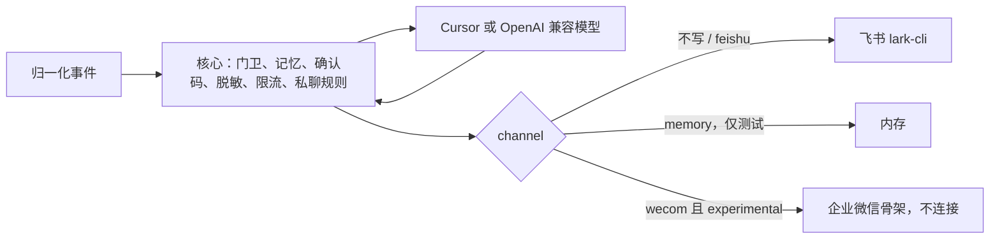

# 渠道适配器

飞书仍然是现在唯一默认接上的渠道。这一层把「耳朵和嘴」从核心里分开，以后要接企业微信、QQ 时，只加一个适配器，不去改门卫、确认码、脱敏和记忆。

没写 `channel` 的旧配置继续走飞书，命令行参数和配置键都不改。

源文件是 [arch-channel.mmd](arch-channel.mmd)。企业微信该接哪一种官方接口，写在 [渠道-企业微信.md](渠道-企业微信.md)。

## 谁负责什么

| 位置 | 负责 |
|---|---|
| `channels/base.py` | 能力名称、工具和能力的对应、缺能力时的一句说明 |
| `channels/feishu.py` | 飞书事件分类，以及 lark-cli 的收、发、改、撤回、成员、群列表。主动私聊和摘要走 `push_text` |
| `channels/memory.py` | 测试用的内存渠道。不联网 |
| `channels/wecom.py` | 实验骨架。默认不加载，加载了也不连接 |
| `agentbot.py` | 答不答、拼提示词、进度卡片的节奏、出口脱敏。飞书时仍打原来的日志 |
| `tools.py` | 只读和写入。确认码、白名单、审计仍在这里。渠道没有的工具直接拒绝 |
| `guard.py` | 脱敏和话题红线。渠道不改写正文 |

核心看见的事件仍是这些字段：`message_id`、`chat_id`、`chat_type`（`group` 或 `p2p`）、`sender_id`、`content`、`mentions`、`root_id`、`thread_id`。飞书长连接推来的包，由飞书适配器拆成这个形状。企业微信的回调要在适配器里拆，不能让核心去认 `msgid` 或 `userid`。

## 能力

渠道用一组名字声明自己会什么。核心在两处看这张表：

- 拼提示词时，没有的工具不放进「当前启用」。
- 模型仍然输出了这个工具时，不调用传输，直接告诉用户这个渠道没有这项能力。

| 能力 | 飞书 | 没有时 |
|---|---|---|
| `receive` | 长连接 | 不启动接收进程 |
| `send_text` | 回复文字 | 不能作答 |
| `edit_text` | 改文字状态消息 | 文字进度不再改写，答案另发 |
| `cards` | 状态卡片 | 进度改用文字 |
| `card_update` | 原地改卡片 | 卡片发出去之后不再刷新 |
| `reactions` | 处理中 / 完成表情 | 不加表情 |
| `recall` | 撤回自己的状态消息 | 不撤回，改成「已完成」或留着 |
| `history` | 群历史 | 不提供 `history`，停机补答也跳过 |
| `attachments` | 当前会话附件 | 不提供 `message_attachment` |
| `members` | 群成员 | 按群成员放行的私聊一律拒绝 |
| `chat_list` | 所在的群 | 自动认群时不同步群列表 |
| `identity` | `bot_open_id` | 无法判断是不是在 @ 自己 |
| `docs` | 云文档 | 不提供文档读写 |
| `calendar` | 日历 | 不提供日程读写 |
| `bitable` | 多维表格 | 不提供表格读写 |
| `threads` | 话题回复 | 回复不进话题 |

知识库 `kb_read` 和技能不在这张表里。它们读的是本机文件，换渠道也不受影响。

飞书这张表是满的，所以提示词里的工具名单、进度卡片和确认码流程与改之前相同。

## 配置

| 键 | 不写时 | 说明 |
|---|---|---|
| `channel` | `feishu` | 也可以写 `lark`。`memory` 或 `fake` 只给测试。`wecom` 见下一行 |
| `channels.experimental` | 假 | 只有写成 `true` 才允许加载企业微信骨架。环境变量 `AGENTBOT_EXPERIMENTAL_CHANNELS=1` 同样只给本机测试 |

`wecom` 没开实验开关时，程序在启动前退出，不会去连企业微信。开了之后骨架的 `ready()` 仍是假，正式启动会退出，仍然不会建 WebSocket。

密钥不能写进配置。企业微信若要试，只写 `wecom.secret_env` 这种环境变量的名字。写了 `secret`、`token`、`encoding_aes_key` 或 webhook 地址，骨架拒绝加载，报错里不回显那段值。

## 不在适配器里做的事

- 6 位确认码仍绑发起人、会话和话题。适配器看不到码，也不能代替确认。
- 脱敏在回复进适配器之前做。适配器收到什么就发什么，所以核心不能把未打码的正文送进去。
- 默认不主动发消息。断线私聊、早晨摘要和播报只有配置打开才发，并且走适配器的 `push_text`。飞书这项用 `im +messages-send`，不经过事件长连接，也不启动收消息的进程。企业微信骨架的 `push_text` 直接失败，不会去连接。
- 公网访问的 SSRF 检查仍在模型上网那一层，不因为换了渠道而放宽。
